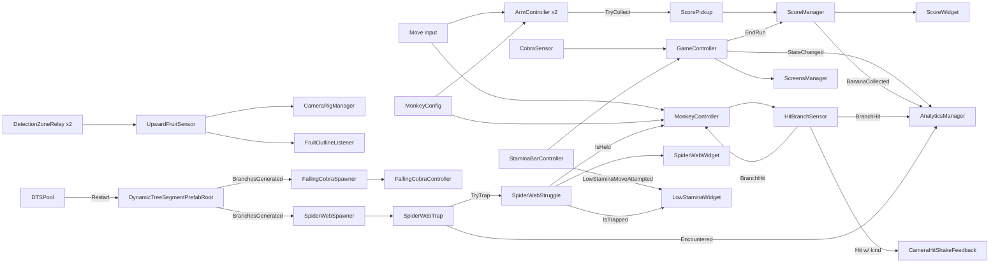

# Monkobra CONTEXT

Descriptive knowledge of this repository for agents and developers.

- Belongs Here: what the system is, ie architecture, domain model, API surface, patterns, known gaps; only what the code cannot show, as it stands, never its history
- Size: stay lean for the context window; when the file grows, move detail to `docs/` or cut it
- Upkeep: update in the same change that moves architecture, patterns, commands, or environment variables
- Structure: follow the existing sections; keep every statement true for every contributor
- Belongs in `AGENTS.md`: prescriptive rules for agents, ie commands, conventions, constraints, do/don't
- Belongs in `docs/`: system documentation for users and agents alike; link it from here, never grow this file to hold it
- Local Layer: put machine-specific or personal context in `CONTEXT.local.md`; create it if missing, never commit it

## Project Overview

Monkobra is a Unity course project (USC CSCI-526, Fall 2026). Where each kind of knowledge lives:

| Topic | Home |
| --- | --- |
| Concept, pillars, mechanics, difficulty intent | [Game Design Document](docs/monkobra-gdd.md) |
| Stack, scenes, run lifecycle, monkey, tree, stamina, score, input, UI, conventions | [Technical Design Document](docs/monkobra-tdd.md) |
| Cobra, falling cobra, branches, spider webs, touch outcomes | [Mobs](docs/mob-doc.md) |
| Detection zones, reach, release check, camera swap, outlines | [Grab System](docs/grab-doc.md) |
| Why difficulty follows height, the roll model, the single balance asset | [Balance Design](docs/balance-doc.md) |
| The run from start to loss, as one diagram | [Gameplay Loop](docs/gameplay-loop-doc.md) |
| Controls, setup | [README](README.md) |
| Git flow for teammates (Chinese) | [Work with Git](docs/work-with-git.md) |
| The three builds (WebGL for GitHub Pages, WebGL for itch.io, Windows), Player Settings, deploys | [Build](docs/build-doc.md) |
| Agent rules | [AGENTS.md](AGENTS.md) |

This file is the script index and the map of how the pieces connect. Behavior and numbers live in the documents above, never here.

## Repository Layout

```text
monkobra/
├── README.md          human onboarding
├── AGENTS.md          agent rules
├── CONTEXT.md         this file
├── CHANGELOG.md       version history, plus open triage tags in a comment
├── docs/              design, technical, mob, grab, balance, gameplay loop, build, and git documents
├── Assets/
│   ├── _Monkobra/     all authored assets, <Type>/<Module>/<asset>
│   │   ├── Scenes/    Lv1Scene
│   │   ├── Scripts/   Analytics/, Cameras/, Environment/, GameController/, HackShortcuts/, MobFallingCobra/, MobGreatCobra/, MobSpiderWeb/, Player/, Scoring/, UI/
│   │   ├── Plugins/   WebGL/Download.jslib (browser download of a text file)
│   │   ├── Prefabs/   Environment/, Mob/, Player/, UI/
│   │   ├── Materials/ Environment/, Mob/, Player/
│   │   ├── Input/     InputSystem_Actions
│   │   ├── Shaders/   Environment/FruitOutline (inverted-hull Shader Graph)
│   │   └── Settings/  GameBalanceConfig, Analytics/, HackShortcuts/, Mob/ placement, _Shared/ URP assets and MonkeyConfig
│   ├── TextMesh Pro/  imported TMP essentials, not authored
│   └── Readme.asset   Unity template leftover
├── Monkobra/          committed WebGL export served by GitHub Pages
├── Packages/          manifest & lock
└── ProjectSettings/   Unity project settings
```

The repository root is the Unity project root. `Library/`, `Temp/`, `Logs/`, `UserSettings/`, `*.csproj`, and `*.slnx` are ignored.

## How the Pieces Connect



## Script Index

All under `Assets/_Monkobra/Scripts/`. Each row names the owner of the detail.

| Script | Role | Detail |
| --- | --- | --- |
| `GameController/GameController`, `GameState` | singleton, owns the `GameState` machine: Tutorial, StarterZone, Playing, Lost; `LoseGame()` takes no cause, analytics infers it | [TDD](docs/monkobra-tdd.md#run-lifecycle) |
| `GameController/StarterZoneExitRelay` | on a trigger collider GO: the monkey entering calls `EndStarterZone()` | [TDD](docs/monkobra-tdd.md#run-lifecycle) |
| `GameController/GameBalanceConfig` | ScriptableObject holding every balance number | [Balance Design](docs/balance-doc.md) |
| `Player/MonkeyController` | kinematic body: orbit, climb, stun, `IsHeld` | [TDD](docs/monkobra-tdd.md#monkey-movement) |
| `Player/MonkeyConfig` | ScriptableObject of monkey tuning and input actions | [TDD](docs/monkobra-tdd.md#monkey-movement) |
| `Player/ArmController` | one arm: climb stroke, reach, release check | [Grab](docs/grab-doc.md#reach-and-release) |
| `Player/DetectionZoneRelay` | side-tagged trigger forwarding enter and exit | [Grab](docs/grab-doc.md#detection) |
| `Player/UpwardFruitSensor` | singleton, reachable and grabbable fruit | [Grab](docs/grab-doc.md#detection) |
| `Cameras/CameraRigManager` | swaps the three Cinemachine cameras | [Grab](docs/grab-doc.md#camera) |
| `Cameras/CameraLookUp` | on the behind camera: tilts the aim point up while climbing | none |
| `Cameras/CameraHitShakeFeedback` | on the main camera: fires a light impulse for a branch hit, a heavier one for a falling cobra hit | [Mobs](docs/mob-doc.md#hit-penalty) |
| `Cameras/CameraCoolDownFeedback` | on the main camera: vignette blackdown and zoom-out pulse on each low-stamina move attempt, a lighter step while low and a stronger one when empty | [TDD](docs/monkobra-tdd.md#camera) |
| `Cameras/CameraEfxConfig` | ScriptableObject of the camera efx tuning: both cool-down steps (vignette, zoom-out) and their timing | [TDD](docs/monkobra-tdd.md#camera) |
| `Player/HitBranchSensor` | singleton branch sensor: raises `BranchHit` and `Hit` (with a `HitKind`); `ReportHit` applies the same drop for a hazard touching the monkey outside the sensor | [Mobs](docs/mob-doc.md#hit-penalty) |
| `Environment/TreeManager` | singleton on the mock tree, marks the trunk axis | [TDD](docs/monkobra-tdd.md#tree) |
| `Environment/DynamicTreeSegmentPrefabRoot` | places branches on a segment, then raises the static `BranchesGenerated` | [Mobs](docs/mob-doc.md#placement) |
| `Environment/DTSPool` | on an empty base marker: instantiates the segments, then recycles the lowest segment over the top, restarting it, for an endless tree | [TDD](docs/monkobra-tdd.md#tree) |
| `Environment/BranchFruitPlacementConfig` | ScriptableObject of branch placement | [Mobs](docs/mob-doc.md#placement) |
| `Environment/BranchWithScriptRoot` | decides whether a branch bears a banana | [Grab](docs/grab-doc.md#fruit-supply) |
| `Environment/FruitOutlineListener` | two-tier banana outline | [Grab](docs/grab-doc.md#feedback) |
| `MobSpiderWeb/SpiderWebSpawner` | on `Envs/DTSPool`: on each `BranchesGenerated`, rolls webs on that segment's trunk against a probability curve at its ramped difficulty | [Mobs](docs/mob-doc.md#placement-1) |
| `MobSpiderWeb/SpiderWebTrap` | web prefab root with one deepened trigger box | [Mobs](docs/mob-doc.md#trap-and-escape) |
| `MobSpiderWeb/SpiderWebStruggle` | on the monkey: trap state, escape bar, immunity | [Mobs](docs/mob-doc.md#trap-and-escape) |
| `MobSpiderWeb/SpiderWebBuilder` | `Build Web` context menu that builds the web strands out of cubes, a one-off authoring aid | none |
| `MobGreatCobra/CobraMotor` | chasing cobra path, coil, look, and balance-driven base speed with a stacking mistake surge (raises `CatchUpStarted`) | [Mobs](docs/mob-doc.md#cobra) |
| `MobGreatCobra/CobraSensor` | cobra contact calls `LoseGame` | [Mobs](docs/mob-doc.md#contact) |
| `MobFallingCobra/FallingCobraSpawner` | on `Envs/DTSPool`: on each `BranchesGenerated`, hangs dormant falling cobras on that segment against a probability curve at its ramped difficulty, some ambushing just above a banana | [Mobs](docs/mob-doc.md#falling-cobra) |
| `MobFallingCobra/FallingCobraController` | dormant until the monkey is near (farther while it reaches for a banana), then warning, a constant fall that slides toward the monkey's angle, and a hit capsule that drops the monkey on any-part contact, at most twice per snake | [Mobs](docs/mob-doc.md#falling-cobra) |
| `GameController/RampedDifficultyManager` | singleton, measures any y above the player's start y (`GetClimbedYDistance`), the climb baseline, and maps any y above the `rampBase` trigger's y (`RampBaseYPosition`) to a 0~1 ramped difficulty via the `rampedDifficultyCurve` in `GameBalanceConfig` | [Balance Design](docs/balance-doc.md#difficulty-follows-height) |
| `Analytics/AnalyticsManager` | scene-placed singleton kept across reloads: observes the game, fills `SessionData` & the open `RunData`, saves one markdown session file per launch to `persistentDataPath/Analytics/` on run events, a timer, and quit or pause; samples height & stamina; dev keys from `HackShortcutConfig`: restart session, mock save, download report (`DownloadReport`) | [TDD](docs/monkobra-tdd.md#analytics) |
| `Analytics/RunData` | plain data of one run: stamps, timed samples of height & stamina, status (`InProgress`, `Lost`, `Interrupted`), end, death cause, scores; also `EventStamp`, `RunSample`, `RunStatus` | none |
| `Analytics/DeathCause`, `Analytics/DeathCauseResolver` | static: infers a lost run's cause from its stamps: a branch hit or web encounter w/i `DeathCauseWindowS` before the loss, else `GreatCobra`; also the display names | [TDD](docs/monkobra-tdd.md#run-lifecycle) |
| `Analytics/MockAnalyticsGenerator` | static: builds a fully mocked `SessionData` & saves it as `0<stamp>-mock.md` beside the real files, live session untouched | none |
| `Analytics/AnalyticsConfig` | ScriptableObject (`Settings/Analytics/AnalyticsConfig.asset`): every analytics tuning value, ie sample & autosave intervals, death cause window | none |
| `Analytics/SessionData` | plain data of one session: title, app version, runs | none |
| `Analytics/AnalyticsMarkdownWriter` | static: renders a run entry with Mermaid graphs & the whole session file with a summary of `Lost` runs, writes the file | none |
| `Analytics/WebDownload` | static: hands a text file to the browser through `Plugins/WebGL/Download.jslib`; false outside a WebGL player | [TDD](docs/monkobra-tdd.md#analytics) |
| `HackShortcuts/HackShortcutConfig`, `HackShortcuts/HackAction` | ScriptableObject (`Settings/HackShortcuts/HackShortcutConfig.asset`): every dev/hack key with its action & help line; `IsActive` is true in development builds only; read by `AnalyticsManager` & `GameController` | [TDD](docs/monkobra-tdd.md#hack-shortcuts) |
| `HackShortcuts/HackShortcutPanel` | on a TMP text: writes one `key: description` line per hack key in `Awake`, hides itself outside a development build | [TDD](docs/monkobra-tdd.md#hack-shortcuts) |
| `Scoring/ScoreManager` | singleton, distance and reward score | [TDD](docs/monkobra-tdd.md#score) |
| `Scoring/ScorePickup` | on a fruit: hands points over once | [Grab](docs/grab-doc.md#on-a-successful-grab) |
| `UI/StaminaBarController` | singleton slider, drains, restores, empty slows monkey | [TDD](docs/monkobra-tdd.md#stamina) |
| `UI/StaminaBarAnimator` | punch on fruit pickup, shake on move attempt while stamina is low | [TDD](docs/monkobra-tdd.md#stamina) |
| `UI/ScreensManager`, `UI/ProgressBarWidget`, `UI/ScoreWidget`, `UI/HeightDisplayWidget`, `UI/LoseScreen` | tutorial panel (goal line, then keyboard-key controls drawn from uGUI Images, `Fonts/UI` subset font) and lose panel, climb progress with the surge cue and red cobra marker, score label, climbed height label, final height, score, and banana count on the lose panel | [TDD](docs/monkobra-tdd.md#ui) |
| `UI/SpiderWebWidget` | first-trap hint and escape bar | [Mobs](docs/mob-doc.md#trap-and-escape) |
| `UI/LowStaminaWidget` | first-low-stamina hint, once per scene load, on the event behind the bar shake and cool-down; hidden on a loss and while a web holds the monkey | [TDD](docs/monkobra-tdd.md#ui) |

## Known Gaps & Constraints

Gaps that belong to one subsystem are listed in [Mobs](docs/mob-doc.md#known-gaps) and the [Grab System](docs/grab-doc.md#known-gaps). Project-wide ones:

- No tests or run commands exist: verification means opening `Lv1Scene` in the Editor
- `DTSPool` deactivates its mock tree, `Envs/Tree`, at runtime, so a component that must run cannot sit under it
- Broader difficulty scaling is not yet designed, see the [Game Design Document](docs/monkobra-gdd.md#difficulty)

## Living Document Maintenance

A stale briefing is worse than none. Update this file in the same pull request that adds, moves, or renames a script, or shifts how the pieces connect. The assistant that made the change writes the update as its final step, and the file stays on the pull-request checklist.
