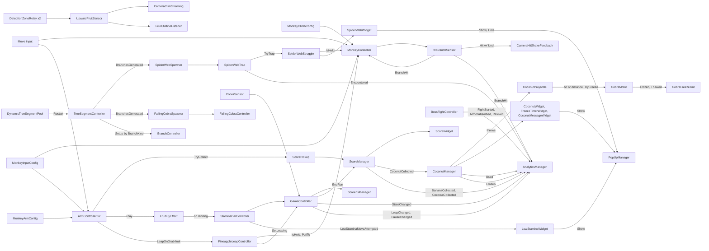

# Monkobra CONTEXT

Descriptive knowledge of this repository for agents and developers.

- Belongs Here: what the system is, ie architecture, domain model, API surface, patterns, known gaps; only what the code cannot show, as it stands, never its history
- Size: stay lean for the context window; when the file grows, move detail to `docs/` or cut it
- Upkeep: update in the same change that moves architecture, patterns, commands, or environment variables
- Structure: follow the existing sections; keep every statement true for every contributor
- Belongs in `AGENTS.md`: prescriptive rules for agents, ie commands, conventions, constraints, do/don't
- Belongs in `docs/`: system documentation for users and agents alike; link it from here, never grow this file to hold it
- Local Layer: put machine-specific or personal context in `CONTEXT.local.md`; create it if missing, never commit it

## Project Overview

Monkobra is a Unity course project (USC CSCI-526, Fall 2026). Where each kind of knowledge lives:

| Topic | Home |
| --- | --- |
| Concept, pillars, mechanics, difficulty intent | [Game Design Document](docs/monkobra-gdd.md) |
| Stack, scenes, run lifecycle, monkey, tree, stamina, score, input, UI, conventions | [Technical Design Document](docs/monkobra-tdd.md) |
| Cobra, falling cobra, branches, spider webs, touch outcomes | [Mobs](docs/mob-doc.md) |
| Detection zones, reach, release check, camera swap, outlines | [Grab System](docs/grab-doc.md) |
| Why difficulty follows height, the roll model, the single balance asset | [Balance Design](docs/balance-doc.md) |
| The run from start to loss, as one diagram | [Gameplay Loop](docs/gameplay-loop-doc.md) |
| Controls, setup | [README](README.md) |
| Git flow for teammates (Chinese) | [Work with Git](docs/work-with-git.md) |
| The three builds (WebGL for GitHub Pages, WebGL for itch.io, Windows), Player Settings, deploys | [Build](docs/build-doc.md) |
| Agent rules | [AGENTS.md](AGENTS.md) |

This file is the script index and the map of how the pieces connect. Behavior and numbers live in the documents above, never here.

## Repository Layout

```text
monkobra/
├── README.md          human onboarding
├── AGENTS.md          agent rules
├── CONTEXT.md         this file
├── CHANGELOG.md       version history, plus open triage tags in a comment
├── DEVLOG.md          weekly development journal, screenshots in devlog-assets/
├── docs/              design, technical, mob, grab, balance, gameplay loop, analytics, build, and git documents
├── devlog-assets/     images embedded by DEVLOG.md
├── builds/            local build output of all three builds, ignored by git
├── Assets/
│   ├── _Monkobra/     all authored assets, <Type>/<Module>/<asset>
│   │   ├── Scenes/    TitleScene, LevelSelectScene, FullPlayScene, EndlessScene; the gameplay scenes are root prefab instances plus the plain `Envs` object, see [Scene Hierarchy](#scene-hierarchy)
│   │   ├── Scripts/   one folder per module (see Script Index), `SceneFlow/Editor/`
│   │   ├── Plugins/   WebGL/Download.jslib (browser download of a text file)
│   │   ├── Prefabs/   per module; `PopUp/` holds `_PopUps`, `_PopUpBase`, `_PopUpFruitBase`, one variant per popup; `World/` holds light, volume, event system, `MenuEventSystem`, `MenuCamera`
│   │   ├── Materials/, Sprites/, Shaders/, Inputs/   per module; `Inputs/InputSystem_Actions`, `Shaders/Environment/FruitOutline` (inverted-hull Shader Graph)
│   │   └── Settings/  `_Shared/` (URP assets, volume profiles) plus one folder per module, assets directly inside
│   ├── WebGLTemplates/ FitWindow/index.html, the 16:9 fit-to-window WebGL page
│   ├── Settings/      Build Profiles/ (GithubPages, ItchIO), Unity-managed
│   ├── TextMesh Pro/  imported TMP essentials, not authored
│   └── Readme.asset   Unity template leftover
├── Monkobra/          committed WebGL export served by GitHub Pages
├── Packages/          manifest & lock
└── ProjectSettings/   Unity project settings
```

## Scene Hierarchy

Four scenes, in build order: `TitleScene` (startup), `LevelSelectScene`, `FullPlayScene` (the normal run), `EndlessScene`. The two menu scenes are shells of `MenuCamera`, `MenuEventSystem`, their screen prefab (`TitleScreen` or `LevelSelectScreen`), `Analytics` and `ControlStyleManager`; the menus read the `InputSystem_Actions` UI map through their own event system, so the gameplay `EventSystem` stays unchanged. `EndlessScene` is a copy of `FullPlayScene` whose only difference is the `GameController.runMode` override (`Endless`), so a gameplay edit inside a shared prefab reaches both scenes, while the plain `Envs` object and the scene-level overrides exist once per scene and are kept in step by hand.

`FullPlayScene`'s root is 10 prefab instances, so teammates edit different files, plus two plain scene objects: `Envs` and a Cinemachine `Target Group`. `Envs`, `Entities` and `UI` nest one prefab per unit. `Envs` has no prefab of its own, so adding or removing one of its children edits `FullPlayScene.unity` itself.

| Root | Nests |
| --- | --- |
| `Cameras` | the climb camera, the three event shot cameras (coconut, cobra alert, leap), the camera anchor and two shot targets, the director, framing and shake components |
| `World/DirectionalLight`, `World/GlobalVolume`, `World/EventSystem` | three separate root prefabs, no wrapper |
| `Envs` (plain scene object) | `DynamicTreeSegmentPool` (with both spawners), `StartingZoneExitTrigger`, `Tree` (mock tree), `RoughBarkSystem` (`RoughBarkSpawner`), `HeightMarkerSystem` (`HeightMarkerSystem`, on the trunk axis) |
| `Player/Entities` | `Monkey`, `GreatCobra` |
| `Boss/BossFight` | `BossFightController`, `BossKingBody`, `BossFightHud`; builds the Cobra King arena at runtime, its position does not matter |
| `Boss/SpiderFight` | `SpiderFightController`, `SpiderKingBody`, `BossFightHud`; builds the Spider King arena at runtime |
| `Resources/Analytics` | one GameObject carrying `AnalyticsManager`, in every scene and made by `PersistentBootstrap` when none exists; the first one is kept across scene loads, a later copy warns and destroys itself |
| `Resources/ControlStyleManager` | one GameObject carrying `ControlStyleManager`, do.; both prefabs sit in `Assets/_Monkobra/Resources/` so `Resources.Load` finds them |
| `GameController/GameController` | one GameObject carrying `GameController`, `ScreensManager`, `ScoreManager`, `RampedDifficultyManager` as components |
| `UI/UI` | the `Canvas`, `TouchControls` (first child, so it draws below everything), `InGameHUD` (`ProgressBar`, `StaminaBar`, `ScoreHeight` (`ScoreHUD`), `PauseButton`, `CoconutHUD`, `CoconutMessage` (widget host only), `FruitFlyLayer`), `FreezeTimerHUD`, `LowStaminaPrompt` (widget host only), `HackShortcutHelp`, `SpiderWebPrompt` (escape bar), `_PopUps` (`PopUp/_PopUps`, before `Screens` so the panels draw over it), `Screens` (`LoseScreen`, `TutorialScreen`, `PauseScreen`) |

Unity drops a reference between two prefab assets, so every link that crosses a root (e.g. `LoseScreen.scoreManager`, `CameraAnchor.monkey`) is a property override on the scene instance. Each object rests in its original active state: owners such as `ScreensManager` switch screens on, managers stay active.

## How the Pieces Connect



## Script Index

All under `Assets/_Monkobra/Scripts/`. Each row names the owner of the detail.

| Script | Role | Detail |
| --- | --- | --- |
| `GameController/GameController`, `GameState` | singleton, owns the `GameState` machine: Tutorial, StartingZone, Playing, Lost, Won, and the scene's `Mode` (`RunMode`, set by the `runMode` field); `LoseGame()` takes no cause, analytics infers it | [TDD](docs/monkobra-tdd.md#run-lifecycle) |
| `GameController/StartingZoneExitRelay` | on a trigger collider GO: the monkey entering calls `EndStartingZone()` | [TDD](docs/monkobra-tdd.md#run-lifecycle) |
| `Player/PlayerBalanceConfig` | ScriptableObject (`Settings/Player/PlayerBalanceConfig.asset`): the player's run balance, ie stamina, starting zone, branch hit, coconut | [Balance Design](docs/balance-doc.md) |
| `Scoring/ScoreConfig` | ScriptableObject (`Settings/Scoring/ScoreConfig.asset`): every score value, ie points per meter and points per reward kind; read by `ScoreManager` | [Balance Design](docs/balance-doc.md) |
| `Environment/WorldBalanceConfig` | ScriptableObject (`Settings/Environment/WorldBalanceConfig.asset`): world balance, ie the pre & post boss ramp curves, the 4 branch kinds (attempts & chance curve each), rough bark, spider web, boss zone & fight | [Balance Design](docs/balance-doc.md) |
| `MobGreatCobra/CobraBalanceConfig` | ScriptableObject (`Settings/MobGreatCobra/CobraBalanceConfig.asset`): falling cobra & great cobra balance | [Balance Design](docs/balance-doc.md) |
| `Player/MonkeyController` | kinematic body: orbit, climb, stun, `IsHeld`, a height ceiling for the boss fight, `SyncOrbitAngle` to land a pulled body on the ring where it is | [TDD](docs/monkobra-tdd.md#monkey-movement) |
| `Player/MonkeyInputConfig` | ScriptableObject (`Settings/Player/MonkeyInputConfig.asset`): the move & interact input actions every monkey consumer reads | [TDD](docs/monkobra-tdd.md#input) |
| `Player/MonkeyArmConfig` | ScriptableObject (`Settings/Player/MonkeyArmConfig.asset`): arm stroke, reach, splay & width | [Grab](docs/grab-doc.md#tuning) |
| `Player/MonkeyClimbConfig` | ScriptableObject (`Settings/Player/MonkeyClimbConfig.asset`): held-time speed curves up and down, exhausted multiplier, idle stamina recovery, orbit speed, deceleration | [TDD](docs/monkobra-tdd.md#monkey-movement) |
| `ItemPineapple/PineappleLeapController` | on the monkey root: runs a leap after a pineapple grab, hands up, pull, landing grace; sets `GameController.IsLeaping`; the pull stops at `BossFightController.LeapTopY` | [Grab](docs/grab-doc.md#pineapple-leap) |
| `ItemPineapple/PineappleLeapConfig` | ScriptableObject (`Settings/ItemPineapple/PineappleLeapConfig.asset`): a pineapple leap's distance, speed curve, hand rise time & landing grace | [Grab](docs/grab-doc.md#pineapple-leap) |
| `Player/ArmController` | one arm: climb stroke, reach, release check | [Grab](docs/grab-doc.md#reach-and-release) |
| `Player/DetectionZoneRelay` | side-tagged trigger forwarding enter and exit | [Grab](docs/grab-doc.md#detection) |
| `Player/UpwardFruitSensor` | singleton, reachable and grabbable fruit; the target and reach side follow the fruit closest to the monkey, re-picked every physics step | [Grab](docs/grab-doc.md#detection) |
| `Cameras/CameraAnchor` | the one transform every camera tracks: the monkey's rendered position with an eased, dead-zoned yaw round the trunk, so strafing never spins the world; reads `CameraConfig` | [TDD](docs/monkobra-tdd.md#camera) |
| `Cameras/CameraConfig` | ScriptableObject (`Settings/Cameras/CameraConfig.asset`), the one camera tuning asset: anchor, climb framing, the three shots, shake, stamina vignette, comfort | [TDD](docs/monkobra-tdd.md#camera) |
| `Cameras/CameraClimbFraming` | on the climb camera: the upward rest aim, a lead from the target's real vertical speed, a grab shift toward the fruit side picked once per press, and `SetBossFraming` for the boss fight view | [Grab](docs/grab-doc.md#camera) |
| `Cameras/CameraRigManager` | the shot director on the `CameraRig`: cuts to the coconut, cobra alert, or leap shot by priority, minimum hold, cap and cooldown, never touches the interact action; blend times per camera pair in `Settings/Cameras/CameraBlends.asset` | [TDD](docs/monkobra-tdd.md#camera) |
| `Cameras/CameraShotTarget` | the point the coconut shot tracks: the anchor blended with the thrown coconut, anchor yaw kept, holds the last spot when the coconut is gone | [TDD](docs/monkobra-tdd.md#camera) |
| `Cameras/CameraCobraAlertFraming` | on the cobra alert camera: moves its focus only in height to the middle of the cobra's own coil, stands close at a set horizontal distance looking down by a set angle, widens the field of view to fit the whole cobra | [Mobs](docs/mob-doc.md#camera-alert) |
| `Cameras/CameraLeapFraming` | on the leap camera: the higher aim and the pull-back along its own direction while a pineapple leap runs | [TDD](docs/monkobra-tdd.md#camera) |
| `Cameras/CameraHitShakeFeedback` | on the main camera: fires a light impulse for a branch hit, a heavier one for a falling cobra hit, scaled by `CameraConfig` | [Mobs](docs/mob-doc.md#hit-penalty) |
| `Cameras/CameraRoughBarkShake` | on the `CameraRig`: eases the Perlin noise of every camera up while the monkey moves on rough bark | [Mobs](docs/mob-doc.md#rough-bark-shake) |
| `Cameras/CameraCoolDownFeedback` | on the main camera: vignette blackdown pulse on each low-stamina move attempt, a lighter step while low and a stronger one when empty, no zoom; takes the shared screen-edge slot first | [TDD](docs/monkobra-tdd.md#camera) |
| `Cameras/ScreenVignetteArbiter` | singleton on the `CobraProximityVignette` prefab: the one slot the stamina and cobra vignettes share, a refused ask waits so the two alternate | [TDD](docs/monkobra-tdd.md#camera) |
| `Player/HitBranchSensor` | singleton branch sensor: raises `BranchHit` and `Hit` (with a `HitKind`); `ReportHit` applies the same drop for a hazard touching the monkey outside the sensor | [Mobs](docs/mob-doc.md#hit-penalty) |
| `Environment/RoughBarkZone` | raised, irregular bark patch on the trunk that smoothly slows the monkey in every direction while touched; avoidable | [Mobs](docs/mob-doc.md) |
| `Environment/RoughBarkSpawner` | on the `RoughBarkSystem` prefab: rolls broad patches ahead of the monkey, off obstacles, from `roughBarkSpawnProbabilityCurve` at the ramped difficulty | [TDD](docs/monkobra-tdd.md) |
| `Environment/TreeManager` | singleton on the mock tree, marks the trunk axis | [TDD](docs/monkobra-tdd.md#tree) |
| `Environment/TreeSegmentController` | places branches on a segment, one prefab per `BranchKind` (empty, banana, coconut, pineapple), first growing the guaranteed pineapple & coconut branch at its exact height, then rolled rarest first, each from its own attempts & curve at the segment's ramped difficulty, skipping spots w/i `startingZoneBranchClearRadiusU` of the monkey before the run is playing & spots in the boss zone, growing only banana branches at the flat `startingZoneBananaBranchChance` below the exit trigger (`RampedDifficultyManager.IsInStartingZoneY`), then raises the static `BranchesGenerated` | [Mobs](docs/mob-doc.md#placement) |
| `Environment/DynamicTreeSegmentPool` | on an empty base marker: instantiates the segments, then recycles the lowest segment over the top, restarting it, for an endless tree | [TDD](docs/monkobra-tdd.md#tree) |
| `Environment/HeightMarkerSystem` | on `Envs/HeightMarkerSystem`: the climbed height every `intervalU` beside the trunk, on both its left and right as seen from the camera, in world units labelled m, on a generated dark rounded plate, from a pool of TextMeshPro labels keyed to height, never to segments; pulses a marker the first time the monkey touches its `HeightMarkerTrigger` and raises `MarkerReached` for the score, a prefab trigger at the marker's exact height while the plate is drawn on its label anchor above; the boss fight's height marker gets a bigger, red, beating plate w/ a small king look-alike, hidden once the fight begins | [TDD](docs/monkobra-tdd.md#ui) |
| `Environment/HeightMarkerTrigger` | on the `HeightMarker` prefab root: a thin trigger slab at one marker's exact height, raises `Passed` when a physical part of the monkey touches it; its `LabelAnchor` child, a fixed way above, is where the plate is drawn | [TDD](docs/monkobra-tdd.md#ui) |
| `Environment/BranchFruitPlacementConfig` | ScriptableObject (`Settings/Environment/BranchFruitPlacementConfig.asset`) of branch placement | [Mobs](docs/mob-doc.md#placement) |
| `Environment/BranchController` | on each branch prefab variant: `Setup` shows the fruit its `BranchKind` names, a banana, or a coconut or pineapple from its `fruitPrefab`, or none | [Grab](docs/grab-doc.md#fruit-supply) |
| `Environment/BranchKind` | enum of the 4 branch kinds: Empty, Banana, Coconut, Pineapple; keys the per kind config & prefab | [Mobs](docs/mob-doc.md#placement) |
| `Environment/FruitOutlineListener` | two-tier fruit outline, on the object holding the fruit's collider | [Grab](docs/grab-doc.md#feedback) |
| `Environment/FruitFlyOnGrab` | on a fruit's root: its fly target and sprite; the `Coconut` and `Pineapple` prefabs carry one, the banana none | [Grab](docs/grab-doc.md#fruit-fly) |
| `ItemPineapple/LeapOnGrab` | marks a fruit whose grab starts a leap | [Grab](docs/grab-doc.md#pineapple-leap) |
| `MobSpiderWeb/SpiderWebSpawner` | on `Envs/DynamicTreeSegmentPool`: on each `BranchesGenerated`, rolls webs on that segment's trunk against a probability curve at its ramped difficulty | [Mobs](docs/mob-doc.md#placement-1) |
| `MobSpiderWeb/SpiderWebTrap` | web prefab root with one deepened trigger box | [Mobs](docs/mob-doc.md#trap-and-escape) |
| `MobSpiderWeb/SpiderWebStruggle` | on the monkey: trap state, escape bar, immunity; `ForceRelease` frees the monkey at once, eg for the boss fight | [Mobs](docs/mob-doc.md#trap-and-escape) |
| `MobSpiderWeb/SpiderWebBuilder` | `Build Web` context menu that builds the web strands out of cubes, a one-off authoring aid | none |
| `MobGreatCobra/CobraMotor` | chasing cobra path, coil, look, and balance-driven base speed with a stacking mistake surge (raises `CatchUpStarted`) and a timed boost on leaving the starting zone (raises `ChaseStarted`); `TryFreeze` holds it still for a coconut (raises `Frozen`, `Thawed`); `StartGuard` / `StopGuard` hold it below the boss arena, `KnockBack` throws the head back when the gold armor takes a bite | [Mobs](docs/mob-doc.md#cobra) |
| `MobGreatCobra/CobraFreezeTint` | next to `CobraMotor` on the `GreatCobra` prefab: tints the body light blue while frozen, blinking near the end, eyes untouched | [Mobs](docs/mob-doc.md#coconut-freeze) |
| `ItemCoconut/CoconutManager` | singleton on the `GameController` prefab: counts the run's coconuts, throws one on its `UseCoconut` input action (a double-tap), starts `CobraMotor.TryFreeze` when it lands, relays the cobra's freeze events, and switches the coconut HUD roots on (they start inactive) | [Grab](docs/grab-doc.md#coconut) |
| `ItemCoconut/CoconutProjectile` | the thrown coconut (`Prefabs/ItemCoconut/CoconutProjectile`): falls straight down, ends on touching the cobra or after a fixed distance | [Grab](docs/grab-doc.md#coconut) |
| `MobGreatCobra/CobraSensor` | cobra contact calls `LoseGame`, unless the boss fight's gold armor absorbs it (`BossFightController.TryAbsorbCobraCatch`) | [Mobs](docs/mob-doc.md#contact) |
| `Boss/BossFightController` | on the `Boss/BossFight` prefab: starts the boss fight at `bossTriggerHeightU` inside the boss zone, clears the branches near its nest, puts the great cobra on guard, caps the monkey's climb below the king, runs the rest/attack loop (bite, tail sweep, minions, head butt), banana branches whose grabbed bananas are also thrown in an arc at the crown, the EASY / NORMAL mode choice, the golden banana shield (`TryThrow`), king health, speech, the slow-motion finisher, an ad revive (any number of times) that restarts the fight with the mode choice, and the win reward: the armor kept as the run goes on (`TryAbsorbCobraCatch`, which in the fight flies the monkey back to the start, `ReturnToStart`) after a reward panel that stops time till Space or Continue; also exposes `BuildMarkerFigure` & `TriggerHeightU` for the trunk height marker, & raises `FightStarted`, `ArmorAbsorbed`, `Revived`; in Endless mode it skips the fight and starts as `StartAsDone`: armor worn, hazards on, no boss marker | [Mobs](docs/mob-doc.md#cobra-king-boss) |
| `Boss/SpiderFightController` | on the `Boss/SpiderFight` prefab: the Spider King fight at `spiderTriggerHeightU` after the Cobra King: silk knots ripped by grabs (`TryGrab`, double damage in its territory), repair of knots near it, web shot / silk hook / cocoon / leg swipe, the banana lure tossed to the far side, the kept gold armor (`BossFightController.TrySpendArmor`), revive, and the silk gloves reward (`SpiderWebStruggle.EscapeGainScale`) | [Mobs](docs/mob-doc.md#spider-king-boss-2) |
| `Boss/SpiderKingBody` | the Spider King built at runtime from primitives, posed on the bark: walking legs, eye glow for wind ups, leg swipe, eating bob, fall on defeat | [Mobs](docs/mob-doc.md#spider-king-boss-2) |
| `Boss/BossKingBody` | the Cobra King built at runtime from simple primitives: head tracking the monkey, strikes (butt & bite), crown jewel weak spot glow, hit flash, shatter into cubes freeing the crown; `BuildFigure` makes a small look-alike for the trunk height marker | [Mobs](docs/mob-doc.md#cobra-king-boss) |
| `Boss/BossKingContact` | on the king's root: raises `Touched` while a physical part of the monkey overlaps the king | [Mobs](docs/mob-doc.md#cobra-king-boss) |
| `Boss/BossFightHud` | boss fight UI built at runtime: entry flash, health bar, speech bubble, first-throw key prompt, EASY / NORMAL tags, damage numbers & words, banners, the kept-armor badge, the win's reward panel (Continue button), revive card & mock course ad | [Mobs](docs/mob-doc.md#cobra-king-boss) |
| `MobFallingCobra/FallingCobraSpawner` | on `Envs/DynamicTreeSegmentPool`: on each `BranchesGenerated`, hangs dormant falling cobras on that segment against a probability curve at its ramped difficulty, some ambushing just above a banana | [Mobs](docs/mob-doc.md#falling-cobra) |
| `MobFallingCobra/FallingCobraController` | dormant until the monkey is near (farther while it reaches for a banana), then warning, a constant fall that slides toward the monkey's angle and stops against tree branches, and a hit capsule that drops the monkey on any-part contact, at most twice per snake | [Mobs](docs/mob-doc.md#falling-cobra) |
| `GameController/RampedDifficultyManager` | singleton, measures any y above the player's start y (`GetClimbedYDistance`), the climb baseline, and maps any y to a ramped difficulty: 0 up to the `rampBase` trigger's y (`RampBaseYPosition`), `preBossRampCurve` to the boss zone start (0~1), a flat 1 in the zone (`IsInBossZoneY`), `postBossRampCurve` after its end (above 1), all in `WorldBalanceConfig`; in Endless mode it reads the post boss curve from the starting zone exit on and has no boss zone | [Balance Design](docs/balance-doc.md#difficulty-follows-height) |
| `Analytics/AnalyticsManager` | singleton on the `Analytics` prefab, kept across scene loads (`DontDestroyOnLoad`, a later duplicate destroys itself): one session and file per launch, runs tagged with the scene's `RunMode`; a load closes an open run as `Interrupted`; observes the game, fills `SessionData` & the open `RunData`, saves one markdown session file to `persistentDataPath/Analytics/` on run events, a timer, and quit or pause; samples height & stamina; dev keys from `HackShortcutConfig`: restart session, mock save, download report (`DownloadReport`) | [TDD](docs/monkobra-tdd.md#analytics) |
| `SceneFlow/SceneNames`, `SceneFlow/RunMode` | the scene name constants and `Load(name)`, the one way to load a scene (resets time scale & audio pause, raises `Loading` first); `RunMode` is `Full` or `Endless` | [TDD](docs/monkobra-tdd.md#scenes) |
| `SceneFlow/ProgressStore`, `SceneFlow/Editor/ProgressMenu` | PlayerPrefs flag that unlocks Endless once the Cobra King is beaten (`MarkBossBeaten` from `BossFightController.Defeat`); Editor menu `Monkobra/Unlock Endless`, `Monkobra/Reset Progress` | [TDD](docs/monkobra-tdd.md#scenes) |
| `TitleScreen/TitleScreen` | Space, a click or a tap opens the level selection (the `UI/StartPress` action), after an input delay; prompt pulses on unscaled time | [TDD](docs/monkobra-tdd.md#scenes) |
| `LevelSelectScreen/LevelSelectScreen` | Normal Play, Endless Mode (greyed out until unlocked), Back; Esc is Back | [TDD](docs/monkobra-tdd.md#scenes) |
| `UI/MenuButtonHover`, `UI/MenuSelectionKeeper` | menu helpers: hover selects a button so mouse and keys share one highlight; the keeper reselects the last button after a click on empty space | [TDD](docs/monkobra-tdd.md#scenes) |
| `ControlStyle/ControlStyle`, `ControlStyle/ControlStyleManager` | enum `Keyboard` or `Touch`, and the singleton on the `ControlStyleManager` prefab, kept across scene loads: a touch press selects Touch, a real key press selects Keyboard, the mouse never switches; static `Current`, `IsTouch` and `StyleChanged` need no instance | [TDD](docs/monkobra-tdd.md#input) |
| `Bootstrap/PersistentBootstrap` | static, runs `BeforeSceneLoad`: creates `Analytics` and `ControlStyleManager` from `Resources/` when their `I` is null, so any scene, a personal dev scene included, plays with both | [TDD](docs/monkobra-tdd.md#control-style) |
| `ControlStyle/ControlStyleLabel`, `ControlStyle/ControlStyleSwitch` | follow `StyleChanged`: one text under a keyboard and a touch wording, and the owner that shows a keyboard group or a touch group of objects | [TDD](docs/monkobra-tdd.md#input) |
| `ControlStyle/HintIconSlot` | shows the animated icon prefab of a hint for the style in use (`Prefabs/InputIcons/`, Animator on Unscaled Time), scaled under a holder; on popups, `CoconutHUD`, the boss prompt; `Create` builds one from code | [TDD](docs/monkobra-tdd.md#control-style) |
| `Analytics/AnalyticsMetric`, `AnalyticsMetrics` | enum of every event kind a run records, plus the static title & height-column table the report reads; add a metric here | [Analytics](docs/analytics-doc.md#adding-a-metric) |
| `LoseScreen/LoseScreenDownloadWidget` | dev-only button on `LoseScreen` that calls `AnalyticsManager.DownloadReport()`; turns its object off unless `HackShortcutConfig.AreHintsShown`; takes the sibling `Button`, no Inspector Field | [Analytics](docs/analytics-doc.md#dev-keys) |
| `Analytics/RunData` | plain data of one run: events by `AnalyticsMetric` (`GetEvents`, `CountOf`), reward score by `RewardKind`, starting zone exit stamp, timed samples of height & stamina, status (`InProgress`, `Lost`, `Interrupted`), end, death cause, scores; also `EventStamp`, `RunSample`, `RunStatus` | none |
| `Analytics/DeathCause`, `Analytics/DeathCauseResolver` | static: infers a lost run's cause from its stamps: a branch hit or web encounter w/i `DeathCauseWindowS` before the loss, else `GreatCobra`; also the display names | [TDD](docs/monkobra-tdd.md#run-lifecycle) |
| `Analytics/MockAnalyticsGenerator` | static: builds a fully mocked `SessionData` & saves it as `0<stamp>-mock.md` beside the real files, live session untouched | none |
| `Analytics/AnalyticsConfig` | ScriptableObject (`Settings/Analytics/AnalyticsConfig.asset`): every analytics tuning value, ie sample & autosave intervals, death cause window | none |
| `Analytics/SessionData` | plain data of one session: title, app version, runs | none |
| `Analytics/AnalyticsMarkdownWriter` | static, the visualization file: renders a run entry with Mermaid graphs & the whole session file with a summary of `Lost` runs; reads only the data it is given, no file or scene access | none |
| `Analytics/AnalyticsSessionFile` | plain class: session file path, save, browser download try, `WriteFile`; holds no analytics data | none |
| `Analytics/AnalyticsHackKeys` | plain class: polls the analytics dev keys & fires restart, download, mock actions of `AnalyticsManager` | [Analytics](docs/analytics-doc.md#dev-keys) |
| `Analytics/WebDownload` | static: hands a text file to the browser through `Plugins/WebGL/Download.jslib`; false outside a WebGL player | [TDD](docs/monkobra-tdd.md#analytics) |
| `HackShortcuts/HackShortcutConfig`, `HackShortcuts/HackAction` | ScriptableObject (`Settings/HackShortcuts/HackShortcutConfig.asset`): every dev/hack key with its action & help line; `IsActive` is true in every build, `AreHintsShown` in development builds only; read by `AnalyticsManager`, `GameController` & `HackPineappleSpawner` | [TDD](docs/monkobra-tdd.md#hack-shortcuts) |
| `HackShortcuts/HackPineappleSpawner` | on the monkey: its F5 to F8 hack keys spawn a pineapple branch, a coconut branch, a falling cobra or a spider web straight above the monkey, belonging to no segment | [TDD](docs/monkobra-tdd.md#hack-shortcuts) |
| `HackShortcuts/HackShortcutPanel` | on a TMP text: writes one `key: description` line per hack key in `Awake`, hides itself unless `AreHintsShown` (keys still work) | [TDD](docs/monkobra-tdd.md#hack-shortcuts) |
| `PopUp/PopUpManager` | singleton on `Prefabs/PopUp/_PopUps`: shows one popup at a time by `PopUpId`, priority interrupts and queues, run gating, once-per-scene memory, drops all on a loss | [PopUps](docs/pop-up-doc.md#rules) |
| `PopUp/MessagePopUp` | on each popup variant prefab: text with a `{0}` slot, look, show and fade times, priority, flags; `Show` and `Hide` | [PopUps](docs/pop-up-doc.md#where-config-lives) |
| `PopUp/PopUpWorldLink` | on `Prefabs/PopUp/_PopUpFruitBase`: line from the popup bottom center to a world target its owner sets (`FruitGrabPrompt` hands over the reach target); hidden without a target | [PopUps](docs/pop-up-doc.md#parts) |
| `PopUp/PopUpId` | enum of the 8 popup variants, the key callers pass to `Show` | [PopUps](docs/pop-up-doc.md#add-a-popup) |
| `Scoring/ScoreManager` | singleton, distance and reward score, each pickup scored and counted by its `PickupKind`, other good deeds awarded by `AddReward(RewardKind, points)` | [TDD](docs/monkobra-tdd.md#score) |
| `Scoring/ScorePickup`, `Scoring/PickupKind`, `Scoring/RewardKind` | on a fruit: hands points over once, as a banana or a coconut; `RewardKind` names every reason points are awarded (banana, coconut, pineapple, cobra freeze, height marker, web escape) for the score popup | [Grab](docs/grab-doc.md#on-a-successful-grab) |
| `UI/StaminaBarController` | singleton slider, drains, restores, empty slows monkey | [TDD](docs/monkobra-tdd.md#stamina) |
| `UI/StaminaBarAnimator` | punch on fruit pickup, shake on move attempt while stamina is low | [TDD](docs/monkobra-tdd.md#stamina) |
| `UI/FruitFlyEffect`, `UI/FruitFlyTarget` | singleton on `InGameHUD/FruitFlyLayer`: flies a grabbed fruit's sprite to the stamina bar, a top-right anchor, or the monkey, then runs the grab's arrival callback | [Grab](docs/grab-doc.md#fruit-fly) |
| `UI/FruitFlyConfig` | ScriptableObject (`Settings/UI/FruitFlyConfig.asset`): flight duration, look, and easing | [Grab](docs/grab-doc.md#fruit-fly) |
| `UI/ScreensManager`, `UI/ProgressBarWidget`, `UI/ScoreWidget`, `UI/ScoreHeightBossHider` (hides the score HUD from `BossFightController.FightStarted` to `FightEnded`), `UI/ScoreBonusItem` (one popup prefab: plus text, number text, colour per `RewardKind`; bangs in, holds, then floats up and fades), `UI/ScoreBonusWidget` (pool of `ScoreBonusItem` prefabs: a "+N" popup beside the score on every reward, from `ScoreManager.RewardAdded`, oldest recycled past `maxActive`), `LoseScreen/LoseScreen` | tutorial panel (goal line, then keyboard-key controls drawn from uGUI Images, `Fonts/UI` subset font) and lose panel, climb progress, with the surge and chase-start warnings handed to `PopUpManager`, red cobra marker and the cobra gap in world units labelled m, score number (badaboom font, digits and comma only, no prefix), final height, score (number in badaboom, own "Final Score" label), and the banana, pineapple, and coconut count rows (`LoseScreen/LoseScreenCountRow`, icon plus "x12", from `ScoreManager` counts) on the lose panel | [TDD](docs/monkobra-tdd.md#ui) |
| `UI/TouchControlsPanel` | on the `TouchControls` prefab, first child of `UI/UI`: shows its `Content` (full-screen action zone on the virtual gamepad's south button, joystick on its left stick) only in Touch mode while the run is playable | [TDD](docs/monkobra-tdd.md#control-style) |
| `UI/PauseButton` | on the square sprite button top right of `InGameHUD`: click or tap pauses, shown only in a live unpaused run | [TDD](docs/monkobra-tdd.md#ui) |
| `UI/TutorialTouchCutout` | the touch tutorial's blue action area: strips around a hole over the live joystick, hides the white overlay while shown | [TDD](docs/monkobra-tdd.md#control-style) |
| `UI/CoconutWidget` | on `InGameHUD/CoconutHUD`, inactive until the first coconut: icon, count, and a double-tap hint until the first use of the session | [Grab](docs/grab-doc.md#coconut) |
| `UI/CobraProximityVignette` | on the `CobraProximityVignette` prefab, first child of `InGameHUD`: green UI overlay warning of the great cobra close below, bottom half then full ring by height gap, a stepped beat rate per stage, hidden in the starting zone, while frozen, guarding or leaping | [TDD](docs/monkobra-tdd.md#camera) |
| `UI/FreezeTimerWidget` | on the `FreezeTimerHUD` prefab under `_UI`, inactive except while the cobra is frozen: countdown and shrinking bar | [Grab](docs/grab-doc.md#coconut) |
| `UI/CoconutMessageWidget` | on `InGameHUD/CoconutMessage`: turns the coconut events into `PopUpManager.Show` calls for the first coconut, a freeze, a refused freeze, and the thaw | [Grab](docs/grab-doc.md#coconut) |
| `UI/SpiderWebWidget` | escape bar, and the first-trap hint through `PopUpManager`, hidden on escape | [Mobs](docs/mob-doc.md#trap-and-escape) |
| `UI/RunScreenMenu` | options of the pause (Resume, Restart, Exit to Title) and lose (Restart, Exit to Title) screens, next to a `MenuSelectionKeeper`; Exit loads `TitleScene`; on the lose screen a confirm press with nothing highlighted restarts | [TDD](docs/monkobra-tdd.md#run-lifecycle) |
| `PauseScreen/PauseScreenWidget` | pause panel, shown while `GameController.IsPaused` (Esc, R restarts), toggled on `PauseChanged` | [TDD](docs/monkobra-tdd.md#ui) |
| `UI/KeyPromptWidget`, `UI/FruitGrabPrompt` | runtime animated hint icon (hold, then release) following a world point, used by the boss HUD; `FruitGrabPrompt` on the Canvas teaches the grab of each fruit kind with a held popup (`BananaFirst`, `PineappleFirst`, `CoconutGrab`) while an unlearned fruit is in reach or w/i `fruitPopUpDetectRadiusU`, until one of that kind is grabbed in the run | [Grab](docs/grab-doc.md) |
| `Scoring/SessionLeaderboard`, `UI/LeaderboardWidget`, `UI/LeaderboardRowWidget` | simulated rivals fixed per launch; the widget fills the leaderboard nested in `LoseScreen` with the player's rank when it opens | none |
| `UI/LowStaminaWidget` | asks `PopUpManager` for the low-stamina hint on the first event behind the bar shake and cool-down | [TDD](docs/monkobra-tdd.md#ui) |

## Known Gaps & Constraints

Gaps that belong to one subsystem are listed in [Mobs](docs/mob-doc.md#known-gaps) and the [Grab System](docs/grab-doc.md#known-gaps). Project-wide ones:

- No tests or run commands exist: verification means opening `TitleScene` (or a gameplay scene) in the Editor
- `DynamicTreeSegmentPool` deactivates its mock tree, `Envs/Tree`, at runtime, so a component that must run cannot sit under it
- Broader difficulty scaling is not yet designed, see the [Game Design Document](docs/monkobra-gdd.md#difficulty)
