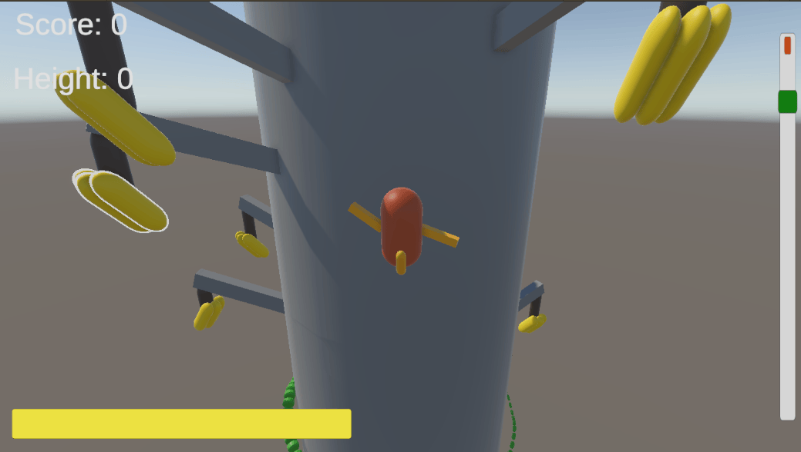

# Monkobra DEVLOG

## Week 9: Alpha 1.0.0-alpha

A first simple playtest of the web build turned up 2 issues:

- Cropped View: on a high-resolution web canvas, players did not realize they saw only a zoomed part of the game. The 1920x1080 canvas overflowed smaller laptop screens, so the edges, & some UI, were cut off
- Rushed Player: the Great Cobra climbed from the first second & chased the player, who did not realize it & could not learn the banana grab system, despite some tries

Our fixes:

- Fixed Resolution: web builds lock to 1280x720 w/ a UI that scales to it. A scaling canvas & a `FitWindow` WebGL template keep 16:9 & fit any browser window, so the whole game shows the same on Mac Retina, 4K & Windows
- Starting Zone: a safe zone at the foot of the tree, so the player is not rushed up. The Great Cobra holds its height & bananas and branches are plentiful, so the player can try, explore & learn to move & grab; once the monkey climbs out, the cobra starts to climb & difficulty ramps from 0
- Start Screen Controls: the start screen shows which key does what, so players need not guess. A drawn keyboard (WASD cluster & wide Space key) is captioned `Move`, `Grab Banana` & `Hold to reach, release to grab`, w/ a bundled font so it renders in WebGL
- Camera Shake & Effects: added so hits & low stamina are felt, not only read off the bar. A Cinemachine impulse shake (light for a branch hit, heavier for a falling cobra), plus a vignette & zoom-out pulse on a move attempt at low stamina, lighter while low & stronger once empty. Tuning lives in one `CameraEfxConfig` asset

*Fixed resolution: in a tall browser window the web build keeps its 16:9 frame & fills the rest with black bars, so nothing is cropped; a Fullscreen button sits at bottom right*

*Starting zone: Score & Height read 0 & branches carry bananas all round the monkey, so the player can practice moving & grabbing before the Great Cobra starts to climb. The banana at top left has the white outline of a grabbable fruit*

*Start screen: a drawn keyboard shows WASD to move & Space to grab a banana (hold to reach, release to grab), with a "Press Space to Start" prompt over the dimmed scene*

*Camera effect: a heavy vignette closes in at height 198 while the stamina bar is nearly empty, the cool-down pulse from a move attempt at low stamina*

## Week 8: Pre-Alpha 0.9.0

- Endless Tree & Difficulty: lowest segment recycles over the top, so a run never ends; climb height maps to 0~1 difficulty driving all hazard chances. Initially fixed stack w/ linear branch count; changed to one shared curve in `GameBalanceConfig`
- Spider Web Trap: web holds the monkey, mash Space to break free. Initially placed once at start on fixed heights; changed to per-segment rolls to fit the recycled tree
- Falling Cobra: dormant until the monkey is near, then drops while sliding round the trunk toward it. Initially timer-unlocked & lethal; changed to per-segment rolls & a stun-and-drop hit
- Great Cobra & Stamina: cobra coils round the trunk, any contact kills. Initially empty stamina ended the run; changed to slow upward climb only, w/ progress bar tracking the cobra by height gap
- Fruit Outlines: 2 tiers, reachable & grabbable. Initially one outline, unclear whether a release would grab; changed to 2 materials matching the Grab System release check
- Run Analytics: per-session markdown report w/ death causes, per-run charts, height & stamina curves; F10 generates a mock session. Initially an event log appended at game over; changed to rewrite on every save plus 10 s autosave

*HUD: score and height (high point) top left, stamina bar bottom left, progress bar right showing the player's height relative to the great cobra. The run is infinite: the tree recycles its segments, so there is no summit*

*Spider web trap: the monkey is held on contact, with a prompt and escape bar to mash Space*

*Fruit outline: reachable fruit (inside the detection zone) gets a weaker outline; grabbable fruit (under the hand, so a release grabs it) gets a stronger one*

*Falling cobra hanging dormant above the monkey, green while asleep*

*Falling cobra awake: it turns red as a warning, then drops while sliding round the trunk toward the monkey*
