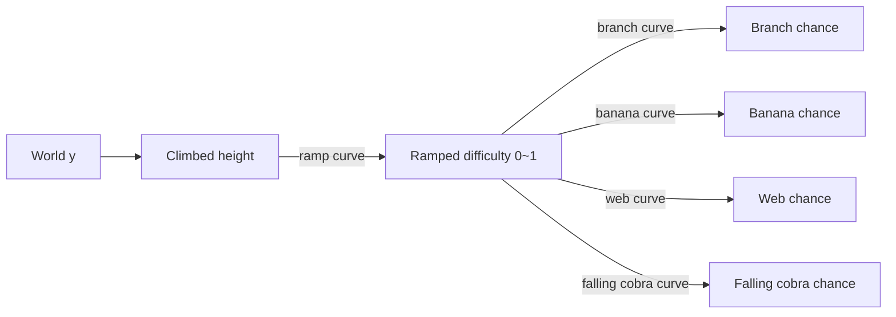

# Monkobra Balance Design

Why difficulty works the way it does: one height-driven ramp, a shared roll model for every hazard, and one asset to tune it all. The numbers are deliberately not here, they live in `Settings/GameBalanceConfig.asset` and change often. The field list and wiring are in the [Technical Design Document](monkobra-tdd.md#game-balance), what each hazard does on touch in [Mobs](mob-doc.md), and the intent behind the difficulty in the [Game Design Document](monkobra-gdd.md#difficulty).

## Design Goals

- One Knob For Pace: how fast the game gets harder is a single decision, not one per hazard
- Skill Sets The Pace: difficulty follows how high the monkey is, so a player who climbs well meets harder content sooner, and one who struggles stays in easier content
- Same Rules For Every Hazard: a designer who understands one spawn rule understands them all
- Data Not Code: no balance value is hard-coded, so a playtest finding is a one-asset edit

## Difficulty Follows Height

Difficulty is not a timer and not the score. It is a single value from 0 to 1, derived only from how far the monkey is above where it started.

- Why Height: height is what the player is trying to maximize, so tying difficulty to it makes the tension track progress; a timer would punish slow play instead of rewarding fast play
- Why 0 To 1: a normalized value lets every hazard curve use the same x axis, so reshaping when difficulty arrives never touches the hazard curves
- Two Baselines: every climb height (score, height display) is measured above the monkey's start y (`GetClimbedYDistance`), while the ramp itself starts at 0 at the y of the starting zone exit trigger (`RampBaseYPosition`), so the protected start is not counted as climbing difficulty. Both are owned by `RampedDifficultyManager`, and nothing else reads raw world y for balance, so shifting the world only means moving those baselines
- Clamped: the ramp curve may extrapolate, but the service clamps its result to 0~1, so past the curve's end difficulty stays at its ceiling and below its start at its floor
- Highest Not Current: score and the lose panel read the highest height reached, so falling and re-climbing is neither rewarded nor double counted

## Two Curves Per Hazard

Pace and density are separated on purpose:

- The ramp curve answers when: how much climbed height it takes to reach each level of difficulty
- A hazard's own curve answers how much: the chance of that hazard at each level of difficulty

Changing the ramp slides every hazard earlier or later together. Changing a hazard's curve reshapes only that hazard. This is why a hazard curve is not allowed to know about heights.

## One Roll Model

The tree is an endless stack of segments recycled upward ([Tree](monkobra-tdd.md#tree)), and every hazard is rolled per segment, when it is placed or restarted:

1. read the segment's ramped difficulty at its middle height
2. sample the hazard's probability curve there, clamped to 0~1
3. make a fixed number of attempts, each succeeding if a uniform roll falls below that chance

- Attempts Are A Ceiling: the attempt count is the most a segment can hold, and the chance says how often it gets there; the expected count is attempts times chance
- Why Attempts: a fixed count of small independent rolls gives natural variety segment to segment without any hazard clumping to a quota
- Why The Middle: a segment is one difficulty step, not a gradient, so every hazard in it shares the same value and a segment reads as one coherent chunk of the climb
- Bananas Differ: they are not rolled per segment; each generated branch rolls once, at its own height, whether it bears one. Branch density and banana supply are therefore both difficulty-linked but tuned apart
- Order Matters: branches are placed first, then webs and falling cobras answer `BranchesGenerated`, so late hazards can keep clear of what already stands
- A Roll Can Place Nothing: webs and falling cobras are skipped when no clear spot is found, so the curve gives the chance of trying, not a guarantee

## Balance Is One Asset

`GameBalanceConfig` is the single home of balance numbers, grouped by system: stamina, movement, branch hit, score, ramped difficulty, branch, spider web, falling cobra, great cobra.

- Why One Asset: balance questions cross systems, since stamina drain, banana supply, and climb speed together decide how long a run lasts; one file keeps them in view together and rules out a second, forgotten copy of a number
- Readers Hold The Reference: each consumer has a `balanceConfig` field pointing at the same asset, so there is no global to trip over, and a test scene can swap in another asset
- What Stays Out: tuning that is geometry or feel rather than balance stays with its owner: arm and orbit in `MonkeyConfig`, branch geometry in `BranchFruitPlacementConfig`, web and falling cobra spawn geometry on their spawners

## The Stamina Loop

Stamina is the pressure that makes the ramp matter, and it couples three balance groups:

- Drain: a cost per distance climbed or orbited, upward costing more than sideways, so wandering is worse than climbing; there is no timer drain, standing still never costs stamina
- Refill: bananas are the only real refill, apart from a slow recovery while the monkey rests
- Supply: banana chance by height decides how often a refill is on offer

Because bananas also cost focus to grab ([Grab System](grab-doc.md)), raising banana supply makes a run easier and also tempts the player into riskier grabs. Tune it knowing it moves both.

## Tuning Guide

- Pace: reshape the ramp curve; it is the only place height maps to difficulty
- Density Ceiling: change a hazard's attempt count
- Density Shape: change a hazard's probability curve
- Fairness Of Refill: change banana supply and the restore amount together, never one alone
- Reading A Change: only segments rolled after an edit reflect it, so play far enough for the pool to recycle, or restart the scene
- Webs Early: the `SpiderWebSpawner` test override skips the curve entirely ([Testing](mob-doc.md#testing))

## Known Gaps

- Every hazard shares one ramp, so a hazard cannot begin at its own height without reshaping its curve to stay flat until then
- A freshly created `GameBalanceConfig` defaults differ from the tuned asset, so a recreated asset plays differently until retuned
- Difficulty ignores how close the chasing cobra is; only the cobra's own surge reacts to the player, speeding up after each hit or web and stacking with repeated mistakes, see [Mobs](mob-doc.md#motion)
