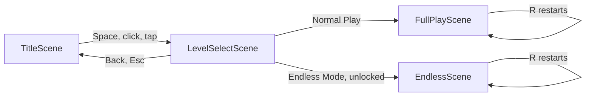
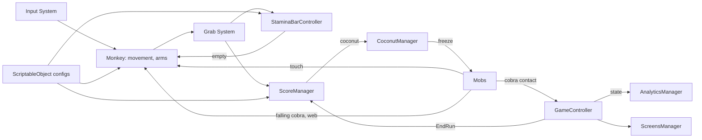
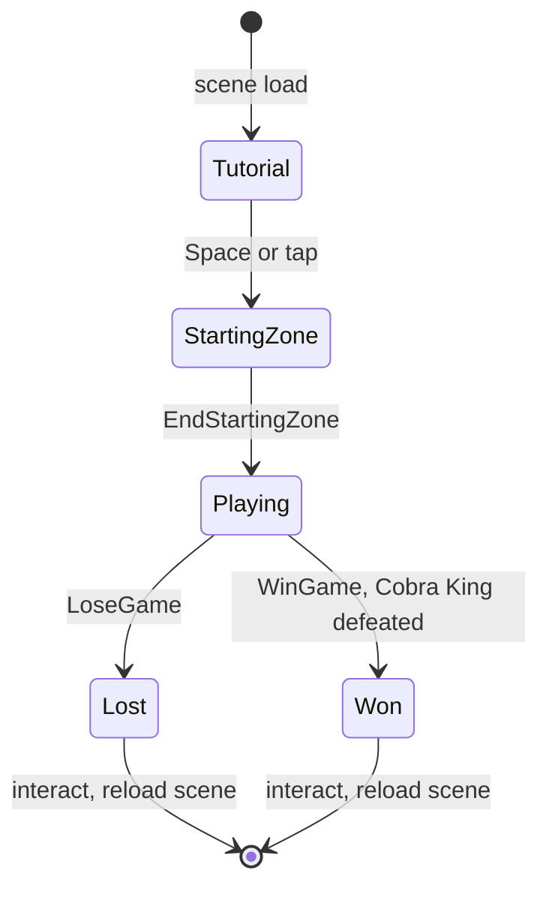
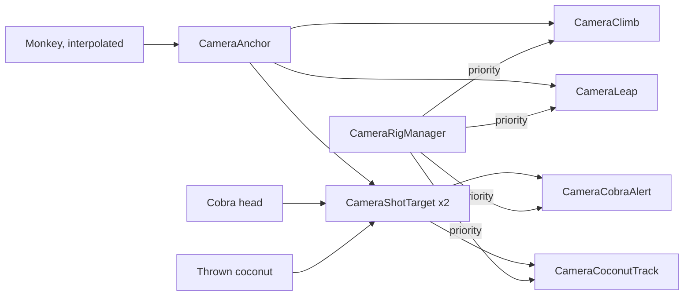

# Monkobra Technical Design Document

How Monkobra is built: the engine and packages, the run lifecycle, the systems that do not belong to one subsystem document, the conventions every script follows, and where to find the rest. Design intent is in the [Game Design Document](monkobra-gdd.md), controls and setup in the [README](../README.md), and the agent-facing system map in [CONTEXT.md](../CONTEXT.md).

## Document Map

| Document | Owns |
| --- | --- |
| [Game Design Document](monkobra-gdd.md) | what the player does and why: pillars, loop, mechanics, difficulty |
| This document | engine, architecture, run lifecycle, game balance, monkey, tree, stamina, score, UI, input, conventions |
| [Mobs](mob-doc.md) | cobra, falling cobra, branches, spider webs, and what each does when the monkey touches it |
| [Grab System](grab-doc.md) | detection zones, arm reach, release check, camera swap, outline feedback |
| [Build](build-doc.md) | the WebGL export, the three builds (WebGL for GitHub Pages, WebGL for itch.io, Windows) and their settings |
| [AGENTS.md](../AGENTS.md) | rules for agents |
| [CONTEXT.md](../CONTEXT.md) | descriptive system map and known gaps |
| [PopUps](pop-up-doc.md) | the center messages: one plate-and-text look, priority and queue, gating, how to add one |
| [Balance Design](balance-doc.md) | why difficulty follows height, the per-segment roll model, the single balance asset |
| [CHANGELOG.md](../CHANGELOG.md) | version history |

A system gets its own document when it spans several scripts and carries rules a reader cannot see from one file. Everything else stays here.

## Stack

| Aspect | Value |
| --- | --- |
| Engine | Unity 6 (`6000.3.22f1`) |
| Render Pipeline | URP 17.3.0, with a PC and a Mobile asset under `Settings/_Shared/` |
| Input | Input System 1.20.0 |
| Camera | Cinemachine 3.1.7 (event shots, impulse shake, noise) |
| UI | uGUI 2.0.0 with TextMesh Pro |
| Target | WebGL on GitHub Pages, built from the Editor |
| Tests | none yet, `com.unity.test-framework` is installed |

## Scenes

| Scene | Purpose |
| --- | --- |
| `TitleScene` | the startup scene of every build: Space, a click or a tap opens the level selection |
| `LevelSelectScene` | Normal Play, Endless Mode (locked until the Cobra King has been beaten once), Back |
| `FullPlayScene` | the normal run; its root is 10 prefab instances (`Cameras`, `DirectionalLight`, `GlobalVolume`, `EventSystem`, `Entities`, `BossFight`, `GameController`, `UI`, `Analytics`, `ControlStyleManager`) plus two plain objects, `Envs` and a Cinemachine `Target Group`; `DynamicTreeSegmentPool` also holds the spider web and falling cobra spawners |
| `EndlessScene` | a copy of `FullPlayScene` with `GameController.runMode` set to `Endless` |

Every scene change goes through `SceneNames.Load`, which resets the time scale and audio pause and raises `Loading` first, so analytics closes the open run. The menu scenes use their own event system (`MenuEventSystem`) bound to the UI map of `InputSystem_Actions`, where Space, Enter and a left click confirm, W, S and the arrows move, and `StartPress` (Space, left click, a touch, gamepad start) serves the title; the gameplay `EventSystem` keeps the package default, so Space never presses a focused gameplay button.

Run mode: `GameController.Mode` (`RunMode.Full` or `Endless`, from the `runMode` field) tells a gameplay scene how to behave. In `Endless` the boss fight is skipped (`BossFightController` starts in its done state, gold armor worn), `RampedDifficultyManager` reads the post boss curve from the starting zone exit on and has no boss zone, and `HeightMarkerSystem` draws no boss marker.

Unlock store: `ProgressStore` keeps one `PlayerPrefs` flag, set once by `BossFightController.Defeat`; the level selection greys Endless out until it is set. The Editor menu items `Monkobra/Unlock Endless` and `Monkobra/Reset Progress` flip it for testing.

Personal copies of `FullPlayScene` are allowed for experiments, see [AGENTS.md](../AGENTS.md#git-workflow).

The folder layout and a script-by-script index are in [CONTEXT.md](../CONTEXT.md#repository-layout).

## Architecture

Subsystems talk through scene singletons, C# events, and trigger callbacks, not through direct scene references. Details are in [Conventions](#conventions).

## Run Lifecycle

`GameController` is the scene singleton that owns the `GameState` machine, exposed as `State` with a `StateChanged` event. A run ends in a loss, or in a win by defeating the Cobra King.

| State | Time Scale | Screen |
| --- | --- | --- |
| Tutorial | 0 | tutorial panel, only Space (a tap anywhere in touch mode) starts the run |
| StartingZone | 1 | none, run is live, `LoseGame` works, until `EndStartingZone()`, called by `StartingZoneExitRelay` when the monkey enters its trigger |
| Playing | 1 | none, never paused |
| Lost | 0 | lose panel with Restart and Exit to Title (`RunScreenMenu`); `RestartAfterLose` (R) reloads the scene after `restartInputDelay`, and so does a confirm press with nothing highlighted |
| Won | 0 | a won run, time frozen, the same restart key reloads the scene |

`LoseGame()` runs once, from StartingZone or Playing: the cobra touches the monkey ([Mobs](mob-doc.md#contact)). It carries no cause: analytics infers one itself (`DeathCauseResolver`): a branch hit or web encounter w/i `AnalyticsConfig.DeathCauseWindowS` before the loss names the cause, otherwise it is the great cobra. `LoseGame` calls `ScoreManager.EndRun` so the score settles, then enters Lost. `ScreensManager` owns the panels: they start deactivated, and it shows the current state's panel in `Start` and on every `StateChanged`.

`WinGame()` currently has no caller: a Cobra King win now continues the run with an armor reward ([Mobs](mob-doc.md#win-reward)). When called it runs once, from StartingZone or Playing: like `LoseGame` it settles the score, then enters Won, which freezes time, and the lose screen's restart key reloads the scene. The boss fight's own win stops time on a reward panel instead, without entering Won. Analytics closes the run as `RunStatus.Won`, left out of the death summaries.

Pause is a flag, not a state: `GameController.SetPaused` (Esc, P or the pause button) works only while the run is live, sets `IsPaused`, freezes time and audio, and raises `PauseChanged`, while `State` keeps its value, so resuming is no state change and analytics never sees a new run. R on the pause screen (`RestartDuringPause`) reloads the scene for a fresh run, like the lose screen's restart (`RestartAfterLose`, R). The pause and lose screens are menus: W, S or the arrows and a mouse hover move the highlight (`MenuSelectionKeeper`, `MenuButtonHover`), Space, Enter or a click confirm, the gameplay `EventSystem` reads the same UI map of `InputSystem_Actions` as the menu scenes, and Exit to Title goes through `SceneNames.Load`. Any state change ends a pause; the key that starts the run from the tutorial is ignored for the pause that frame. Gameplay already stops on `Time.timeScale <= 0`, so nothing else checks the flag.

A pineapple leap is a flag too: `GameController.SetLeaping` sets `IsLeaping` and raises `LeapChanged` while `State` keeps its value, for the same reason, and because the checks of `State == Playing` below must keep passing. It starts only in a live run and ends the starting zone. Hazards check the flag themselves ([Mobs](mob-doc.md#during-a-pineapple-leap)); the sequence is in the [Grab System](grab-doc.md#pineapple-leap).

Gameplay that must stop outside a run checks both `Time.timeScale <= 0` and the state. Grab, pickup, and scoring (`ArmController.TryGrabFruit`, `ScorePickup`, `ScoreManager.CanScore`) check `GameController.IsRunLive` (StartingZone or Playing); `SpiderWebStruggle` and the other HUD checkers still require `Playing`, so webs do not catch in the starting zone.

## Analytics

`AnalyticsManager` is a singleton component on its own `Analytics` prefab, one per scene, and the first one is kept across every scene load: one session and file per launch, menus included. A scene load closes an open run as `Interrupted`, and each run is tagged with the scene's run mode. It observes the run (`GameController.StateChanged`, `ScoreManager.BananaCollected`, `HitBranchSensor.BranchHit`, `SpiderWebTrap.Encountered`, ~), opening a run when the starting zone begins so the zone's fruit, webs, and height count, and fills a `SessionData` of `RunData` entries. Every event is an `AnalyticsMetric` stamped through one `RecordEvent` path, so a new metric is an enum entry, a title row, and one subscription, see [Analytics](analytics-doc.md#adding-a-metric). `AnalyticsMarkdownWriter` renders every metric from one loop and `AnalyticsMarkdownWriter` renders it to one markdown file per scene load under `persistentDataPath/Analytics/`, rewritten on every save. Each run entry carries Mermaid graphs, and the file opens with a summary of lost runs. A run cut short by stopping Play mode, a scene reload, or the restart key is marked `Interrupted` and left out of the summary. Sample and autosave intervals and the death cause window are in `Settings/Analytics/AnalyticsConfig.asset`; the keys are in [Hack Shortcuts](#hack-shortcuts).

A WebGL player cannot reach `persistentDataPath` (it is a virtual IndexedDB filesystem), so the download key renders the session in memory and `WebDownload` hands it to the browser through `Plugins/WebGL/Download.jslib`. A run still open is rendered as it stands and keeps recording. Elsewhere the same key saves the session file and logs its path.

## Hack Shortcuts

Every dev key lives in one asset, `Settings/HackShortcuts/HackShortcutConfig.asset`, an instance of the `HackShortcutConfig` ScriptableObject: a list of entries, each a `HackAction`, a key, and a one-line description. Consumers look a key up with `GetKey(HackAction)` and skip it unless `HackShortcutConfig.IsActive`, which is true in every build, so the keys work in a release build too. Hints and dev-only UI follow `HackShortcutConfig.AreHintsShown` instead, ie a development build or the Editor.

| Key | Action | Read by |
| --- | --- | --- |
| F1 | toggle `GameController.CobraNoClip`, the great cobra no longer kills | `GameController` |
| F2 | toggle max energy: the stamina bar stays at max (`StaminaBarController.IsMaxStamina`) | `StaminaBarController` |
| F3 | toggle the speed buff: climb up, climb down and orbit run at 3 times normal speed (`MonkeyController.IsSpeedBuff`) | `MonkeyController` |
| F4 | jump to the boss zone start: teleport the monkey to `BossZoneStartU`, ending the starting zone if still on, live run only | `MonkeyController` |
| F5 | spawn a pineapple branch straight above the monkey | `HackPineappleSpawner` |
| F6 | spawn a coconut branch straight above the monkey | `HackPineappleSpawner` |
| F7 | hang a dormant falling cobra above the monkey, it wakes and drops on it | `HackPineappleSpawner` |
| F8 | stick a spider web on the trunk above the monkey | `HackPineappleSpawner` |
| F9 | jump to 1000 u below the Spider King, the Cobra King skipped as beaten (armor worn) | `MonkeyController` |
| F10 | download the analytics session report | `AnalyticsManager` |
| F11 | close the analytics session and open a new file | `AnalyticsManager` |
| F12 | save a mock analytics session file | `AnalyticsManager` |

`HackShortcutPanel` on a TMP text writes these lines from the asset in `Awake`, and hides its object unless `AreHintsShown`, ie outside a development build. A new hack key is a new `HackAction` plus an entry in the asset.

## Game Balance

Game balance numbers live in 3 assets plus the score config, split by what they tune (how height becomes spawn chances is in [Balance Design](balance-doc.md)): `Settings/Player/PlayerBalanceConfig.asset` for the player's run, `Settings/Environment/WorldBalanceConfig.asset` for the generated world, and `Settings/MobGreatCobra/CobraBalanceConfig.asset` for both cobras, instances of the `PlayerBalanceConfig`, `WorldBalanceConfig`, and `CobraBalanceConfig` ScriptableObjects. Every score value lives in `Settings/Scoring/ScoreConfig.asset`, an instance of the `ScoreConfig` ScriptableObject, the one asset outside these 3 that holds balance numbers. To tweak the game's feel, edit these 4 files and nothing else: no balance value is hard-coded in a script.

| Asset | Group | Fields | Read by |
| --- | --- | --- | --- |
| `PlayerBalanceConfig` | Stamina | `maxStamina`, `staminaUpwardDrainPerU`, `staminaSidewayDrainPerU`, `fruitStaminaRestore` | `StaminaBarController` |
| 〃 | Starting Zone | `startingZoneStartStaminaFraction`, `startingZoneExhaustedSpeedMultiplier`, `startingZoneIdleRecoveryMultiplier` | `StaminaBarController`, `MonkeyController` |
| 〃 | Branch Hit | `hitStunDurationS`, `hitDropDistanceU`, `hitDropSpeedU` | `MonkeyController`, `CobraMotor` |
| 〃 | Fruit Popup | `fruitPopUpDetectRadiusU` | `FruitGrabPrompt` |
| 〃 | Coconut | `cobraFreezeDurationS`, `coconutThrowSpeedU`, `coconutThrowDistanceU` | `CoconutManager` |
| `WorldBalanceConfig` | Ramped Difficulty | `preBossRampCurve`, `postBossRampCurve` | `RampedDifficultyManager` |
| 〃 | Branch | `startingZoneBranchClearRadiusU`, `startingZoneBananaBranchChance`, and per kind (empty, banana, coconut, pineapple) `<kind>BranchAttemptCount` & `<kind>BranchProbabilityCurve`, plus `coconutGuaranteedHeightU` & `pineappleGuaranteedHeightU` | `TreeSegmentController` |
| 〃 | Rough Bark | `roughBarkSpeedMultiplier`, `roughBarkBlendS`, `roughBarkAttemptCount`, `roughBarkSpawnProbabilityCurve` | `RoughBarkSpawner`, `MonkeyController` |
| 〃 | Spider Web | `webAttemptCount`, `webSpawnProbabilityCurve` | `SpiderWebSpawner` |
| 〃 | Boss Fight | `bossZoneStartU`, `bossTriggerHeightU`, `bossZoneEndU`, `bossMaxHealth`, `bossBananaDamage` | `BossFightController`, `RampedDifficultyManager` |
| `CobraBalanceConfig` | Falling Cobra | `fallingCobraAttemptCount`, `fallingCobraSpawnProbabilityCurve`, `fallingCobraFallSpeedU`, `fallingCobraHorizontalSpeedU`, `fallingCobraReachWakeDistanceU`, `fallingCobraBananaAmbushChance`, `fallingCobraRehitGraceS`, `fallingCobraMaxHits` | `FallingCobraSpawner`, `FallingCobraController` |
| 〃 | Great Cobra | `cobraBaseSpeedCurve`, `cobraDistanceSpeedCurve`, `cobraSurgePerMistakeS`, `cobraMaxSurgeS`, `cobraSurgeSpeedPerMistakeU`, `cobraSurgeStackShareCurve`, `cobraMaxSurgeSpeedU`, `cobraExitBoostSpeedU`, `cobraExitBoostDurationS`, `cobraSpeedChangeRateU` | `CobraMotor` |
| `ScoreConfig` | Height | `pointsPerMeter`, `unitsPerMeter` | `ScoreManager` |
| 〃 | Rewards | `bananaPoints`, `coconutPoints`, `pineapplePoints`, `cobraFreezePoints`, `heightMarkerPoints`, `webEscapePoints` | `ScoreManager` |

- Wiring: each reader holds an inspector field for every slice it needs, never more: `scoreConfig` on `ScoreManager`, `playerBalanceConfig` on `StaminaBarController`, `MonkeyController`, `CoconutManager`, and `CobraMotor` (hit stun only); `worldBalanceConfig` on `MonkeyController` (rough bark), `TreeSegmentController`, `RampedDifficultyManager`, `SpiderWebSpawner`, `RoughBarkSpawner`, and `BossFightController` (boss fight); `cobraBalanceConfig` on `FallingCobraSpawner` and `CobraMotor`, each pointing at the one asset of its slice
- Not Balance: the arm stroke and reach are in `MonkeyArmConfig`; climb build-up, exhaustion, idle recovery, orbit speed, and deceleration are in `MonkeyClimbConfig`; input actions are in `MonkeyInputConfig`; the leap's distance, speed curve, hand rise, and landing grace are in `PineappleLeapConfig`; branch radius, spacing, and retries stay in `BranchFruitPlacementConfig`; web radius, spacing, clearance, retries, and the test override stay on `SpiderWebSpawner`; cobra spawn radius, spacing, retries, and ambush height stay on `FallingCobraSpawner`, and its trigger and fall distances on the falling cobra prefab; the web escape grace and the throw start offset on `CoconutManager`; the height markers' interval, placement, look, and test override stay on `HeightMarkerSystem`
- Retired: `GameConfig`, `ScoreConfig`, and `ScoreReward` were folded into the balance configs and removed
- Suffixes: `U` is world units, `S` is seconds, `Deg` is degrees, `PerU` is per world unit travelled

The balance values in each section below are the current ones; change them in the asset, not in the section.

## Monkey Movement

`MonkeyController` drives the body. Its stun numbers come from [Game Balance](#game-balance), its climb build-up, exhaustion, idle recovery, orbit, and deceleration from `MonkeyClimbConfig`, and its input from `MonkeyInputConfig`.

- Body: kinematic, with gravity off. The script writes position and rotation outright through the Rigidbody, so no arm joint or collision can push it off its path
- Orbit: the horizontal input changes one angle, and the body sits exactly on a ring of fixed radius round its parent, the trunk
- Climb: the vertical input ramps a climb speed along world Y with separate acceleration and deceleration, and different maximums up and down
- Held: `IsHeld` freezes the body in place, set by the web trap ([Mobs](mob-doc.md#trap-and-escape)) and by a [pineapple leap](grab-doc.md#pineapple-leap), which pulls it up meanwhile
- Stun: after a branch hit the input is ignored and the body falls a set distance ([Mobs](mob-doc.md#hit-penalty))
- Stamina Cost: each step reports upward and sideways distance to `StaminaBarController.DrainByMovement`. The stun fall and descending cost nothing

Climb speed builds up along `ClimbUpSpeedCurve` and `ClimbDownSpeedCurve` in `Settings/Player/MonkeyClimbConfig.asset` (x: seconds the key has been held without a break, y: speed in u/s, whose end value is the top speed); the count resets on release, a flip of direction, a stun, or a web hold, and the exhausted multiplier scales the up curve. With no vertical key the climb eases to a stop at `DecelerationU`. Orbit speed and deceleration come from the same asset; the arm stroke and reach tuning are in `Settings/Player/MonkeyArmConfig.asset`, covered by the [Grab System](grab-doc.md#tuning).

## Tree

The tree is a stack of static and dynamic trunk segments under a `TreeTop`, which carries no win zone: a run only loses.

- Extent: `TreeManager` (singleton `I`) holds `MinY` and `MaxY`, 0 and 100 by default, from the finite tree; nothing reads them any more; `FallingCobraSpawner` takes each segment's pivot as the trunk axis
- Climb Height: heights that drive difficulty are measured above the monkey's start y by `RampedDifficultyManager.GetClimbedYDistance`: branch density, banana chance, web chance, falling cobra chance, the score, and the trunk height markers. Nothing shifts the world origin; if something ever does, it only has to move `PlayerGameStartYPosition` along
- Segments: each `TreeSegmentController` places branches on itself in `Start` and in every `Restart` ([Mobs](mob-doc.md#placement)), then raises the static `BranchesGenerated`, which `SpiderWebSpawner` answers with webs ([Mobs](mob-doc.md#placement-1)) and `FallingCobraSpawner` with falling cobras ([Mobs](mob-doc.md#spawning))
- Pool: `DynamicTreeSegmentPool` sits on an empty object, finds the `Player`-tagged object once, and instantiates `segmentCount` copies of `segmentPrefab` end to end, the first (lowest) one created at the world height `firstSegmentY`. It keeps them in a FIFO: only when the stack top is less than `lookAheadU` above the player, and the lowest segment lies wholly under the player, that lowest one is moved over the stack top by `TreeSegmentController.Restart`, which clears its branches and webs and rolls branches again; the webs follow through `BranchesGenerated`, the pool never calls the spawner. Its `mockTree` field names an editor-only stand-in, `Envs/Tree` in `FullPlayScene`, that is deactivated at runtime, so nothing that must run may sit under it

## Stamina

`StaminaBarController` is a singleton `Slider` that reads `PlayerBalanceConfig`. `StaminaBarAnimator` on the same GameObject punches the bar on `FruitConsumed` and shakes it on `LowStaminaMoveAttempted`, which `MonkeyController` triggers through `NotifyMoveAttempt` while an input is held and stamina is below the `lowStaminaFraction` field of `StaminaBarController` (10% by default, 20% on the `FullPlayScene` instance) of the maximum. That threshold is feedback only and sits outside `PlayerBalanceConfig`; only an empty bar changes movement.

- Movement Drain: `DrainByMovement` per physics step, upward distance costs more than sideways; it is the only drain, nothing lowers the bar on a timer or while the monkey stands still
- Restore: `AddStaminaByFruit` adds the per-banana amount, capped at the maximum, when the grabbed fruit's flight lands, so the bar rises and punches together ([Grab System](grab-doc.md#fruit-fly))
- Idle Recovery: `MonkeyController` adds `MonkeyClimbConfig.IdleStaminaRecoveryPerS` per second while no move key is pressed, scaled by `PlayerBalanceConfig.StartingZoneIdleRecoveryMultiplier` during the starting zone
- Depletion: reaching 0 does not end the run: `MonkeyController` scales upward climb speed only by `MonkeyClimbConfig.ExhaustedSpeedMultiplier` until stamina is above 0 again
- Label: the `StaminaBar` prefab carries a white TMP `Energy` label, `EnergyLabel`, above the left end of the bar; it is a child of the root, so it punches and shakes with the bar
- First Low Hint: `LowStaminaWidget` listens to the same `LowStaminaMoveAttempted`, so its once-per-scene hint opens with the first bar shake and cool-down pulse, at the same threshold ([UI](#ui))

All values live in `Settings/Player/PlayerBalanceConfig.asset`.

## Score

`ScoreManager` (singleton `I`, on the `GameController` object) keeps two scores and notifies the UI when the total changes.

- Distance Score: whole meters of the highest point climbed, read from `RampedDifficultyManager.CurrentPlayerClimbedYDistance`, refreshed every frame (player y minus the y at game start), times points per meter. Only a new high counts, so falling and re-climbing earns nothing
- Reward Score: points from each banana collected through its `ScorePickup`; `ScoreManager.BananaCollectedCount` counts those pickups. A coconut's `ScorePickup` (kind `Coconut`) adds the config's coconut points instead, kept in `ScoreManager.RewardScoreOf(RewardKind.Coconut)`, counted in `CoconutCollectedCount`, and raises `CoconutCollected`
- Other Rewards: `ScoreManager.AddReward(RewardKind)` adds to Reward Score for every good deed that is not a fruit pickup, a pineapple grab, a cobra freeze (`CoconutManager.Frozen`), a new height marker reached (`HeightMarkerSystem.MarkerReached`, once per marker above the highest already reached) and a spider web escaped (`SpiderWebStruggle.Escaped`); each grant raises `RewardAdded(RewardKind, points)`, which the score popup reads. The point values are in `ScoreConfig`
- Gate: `CanScore` is true only after start, before `EndRun`, while unpaused, and while the game is not over
- Display: `ScoreWidget` shows the total on the HUD and on the lose panel
- Units: `unitsPerMeter` only converts climbed world units to the meters the distance score pays for. Every height the player reads is plain world units: the trunk height markers and the progress bar's cobra gap label them `m`, and the lose panel's final height shows the bare number

All values live in `Settings/Scoring/ScoreConfig.asset`; `ScorePickup` carries no reward asset of its own.

The test scenes have no `ScoreManager`.

## Camera

One tuning asset, `Settings/Cameras/CameraConfig.asset`, holds every camera value: the anchor easing, the climb framing, the three shots, the shake, the stamina vignette, and the comfort switch. Cinemachine owns blend curves (`Settings/Cameras/CameraBlends.asset`, per camera pair), the impulse shapes (the two `CinemachineImpulseSource` components) and the noise profile, so those stay in their own assets and the config scales them.

- Anchor: every gameplay camera tracks `CameraAnchor`, never the body. It sits on the interpolated position and turns only about the world up axis, from the monkey's angle round the trunk, eased and behind a dead zone, so strafing swings the view gently and a body spin (the boss finisher) never reaches it. The brain updates in `LateUpdate` and the monkey's rigidbody is interpolated, so the world does not judder at the physics rate
- Climb view: the default. `CameraClimbFraming` looks up by default, leads by the target's real vertical speed (not the raw input, so a blocked monkey never tilts the view), raises the aim along an animation curve of look-up vs time the up input has been held (the longer up is held, the higher the view looks, up to the curve's last key, settling back on release) and moves the field of view from its base to its final view along a second curve of zoom-out vs the same hold time, and shifts the aim toward the fruit side while grab is held, the side picked once per press. The boss fight asks for its framing through `SetBossFraming`
- Shots: `CameraRigManager` is the shot director. Coconut track follows a thrown coconut and ends at the landing or at its duration, whichever comes first, cobra alert shows the whole cobra once, when it first starts chasing, moving only up and down, close and looking down by a set angle, and widening its field of view to fit, and the leap shot looks up and pulls back during a pineapple leap. Each shot has a priority, a minimum hold, a duration cap, and a cooldown in the config, so events never chain into rapid cuts: a shot of the same or lower priority than the live one is refused, a higher one preempts it. The coconut and cobra shots frame the monkey and their subject through a `CameraShotTarget`, which keeps the anchor's yaw.
- Hit shake: `CameraHitShakeFeedback` reads `HitBranchSensor.I` and fires one of two `CinemachineImpulseSource` components by hit kind, light for a branch, heavy for a falling cobra, with a force from the config. Every camera carries an impulse listener, so every view shakes
- Rough bark shake: `CameraRoughBarkShake` drives the Perlin noise gains of every camera while the monkey moves on rough bark, easing in and out; standing still on the bark stays calm
- Cool-down: `CameraCoolDownFeedback` listens to `StaminaBarController.LowStaminaMoveAttempted` and pulses a URP Vignette on a global Volume, easing it back to rest, in two steps (below the low fraction, and empty). There is no zoom, since a moving field of view reads as motion. A running pulse ignores repeats and a short cooldown follows
- Cobra proximity: `CobraProximityVignette` (HUD, first child of `InGameHUD`) draws a green UI overlay, since the URP Vignette is black and round only. The height gap to the great cobra's head picks the stage: bottom half, then full ring, each kept a little past its distance so a gap on the edge does not flicker. The overlay beats at a rate per stage, a step and never a ramp. It never shows in the starting zone, nor while the cobra is frozen or guarding, nor during a leap or outside a live run. Distances, rates, color and alpha are in `CameraConfig`
- Vignette slot: `ScreenVignetteArbiter` holds one slot for both vignettes. A stamina pulse or a cobra beat starts only with the slot and frees it at its end; a refused ask is remembered, and the owner that played last yields to a waiting other, so the two alternate. Without an arbiter in the scene both run unchecked
- Comfort: one switch in the config silences the shake and the noise, and drops the lead and the pull-back; a global shake scale also scales every shake

The grab shift is in the [Grab System](grab-doc.md#camera), the hit trigger in [Mobs](mob-doc.md#hit-penalty).

## Input

One asset, `Inputs/InputSystem_Actions`, holds all bindings, referenced through `InputActionReference` fields. The left mouse button is bound only in the `UI` map, for uGUI buttons; the `Player` map binds none. Pause (Esc or P), `RestartAfterLose` (R), and `RestartDuringPause` (R) are `Player` actions assigned to `GameController`. The scheme, with each action's Preferred and Support keys, is in [Input](input-doc.md); the player key list is under Controls in the [README](../README.md#controls).

- Move: shared by the body and both arms through `MonkeyInputConfig`
- Interact: the grab, read by both arms and polled by the climb camera framing; `UseCoconut` is a separate `Player` action on the same keys with a MultiTap interaction (a double-tap, timing set in the asset), enabled and listened to by `CoconutManager`, found by the `inputActions` asset and `useCoconutActionPath` fields
- Jump: the web escape press, read by `SpiderWebStruggle`, the press that starts the run from the tutorial, read by `GameController`, and the boss panels' confirm press, read by `BossFightController`
- Confirm keys: Space, E and Enter are bound alike on Interact, UseCoconut and Jump, and on `UI/Submit` and `UI/StartPress`; they stay separate actions because the coconut double-tap is a MultiTap interaction that a merged action would also put on the grab
- Collision: Space, E and Enter are bound to both Interact and Jump, so the struggle disables interact while the monkey is trapped, by design
- Boss panels: `BossFightController` polls `confirmAction` (`Player/Jump`) and `giveUpAction` (`Player/RestartAfterLose`), never a raw key; the course page is a button only. A shared action is enabled at the moment of use, since `SpiderWebStruggle` disables `Player/Jump` when it is disabled
- Touch: a virtual gamepad stands in for the keyboard. The `TouchControls` prefab's `OnScreenStick` writes `<Gamepad>/leftStick` (Move binds it) and its full-screen `OnScreenButton` writes `<Gamepad>/buttonSouth`, which Interact, UseCoconut and Jump all bind, so one zone grabs, double-taps a coconut, escapes a web and starts the run exactly like Space. A virtual keyboard is avoided because its writes read as real key presses and would flip the control style back
- Start: `UI/StartPress` serves the title: Space, E, Enter, left mouse, a touch press, gamepad start
- Back: `UI/Cancel` serves level select: Esc, P

### Control Style

`ControlStyleManager` (prefab `ControlStyleManager`, kept in every scene and also created by `PersistentBootstrap` from `Resources/` before the first scene when none exists; the first instance is kept across loads, and a later copy destroys itself with a warning that is expected) holds the style, `Keyboard` or `Touch`: a touch press selects Touch, a real key press selects Keyboard, the mouse never switches, and a device with a touch screen and no keyboard starts as Touch. It raises the static `StyleChanged`, and `Current` and `IsTouch` work without an instance. Hints never poll it; they subscribe:

- `ControlStyleLabel`: one text under a keyboard and a touch wording, blank hides it; `Configure` sets both from code
- `ControlStyleSwitch`: shows a keyboard group or a touch group of objects, eg the tutorial's keyboard icons and its touch guide, or a key icon that only a keyboard needs
- `HintIconSlot`: shows the animated icon of a hint, one prefab per style (`Prefabs/InputIcons/`: `SpacePress`, `TouchTap`, each with a `_Double` and `_Rapid` variant), scaled to a fit height under a holder, since the icon's Animator owns its root scale. An icon Animator uses Unscaled Time so it plays while a popup or the pause screen freezes time. `HintIconSlot.Create` builds one from code, as `KeyPromptWidget` does; popups, `CoconutHUD` and the boss prompt hold one
- `TutorialTouchCutout`: the touch tutorial's blue action area, 4 strips around a hole over the live `OnScreenStick`, found at runtime and laid out every frame; hides the tutorial's white overlay while shown
- Scripts with their own wording subscribe themselves: `CoconutWidget` (`useHintText`, `useHintTouchText`), `MessagePopUp` (`touchMessage`, re-worded while a held popup shows), `KeyPromptWidget`; `BossFightHud` gives its runtime labels a `ControlStyleLabel`
- `TouchControlsPanel` shows the touch controls only in Touch mode while the run is playable (tutorial, starting zone, playing; not paused, lost or won). `TouchControls` is the first child of the `_UI` canvas, so every HUD element, popup and screen draws above it and takes its taps first

## UI

| Element | Script | Shows |
| --- | --- | --- |
| Stamina Bar | `UI/StaminaBarController` | current stamina, under an `Energy` label |
| Fruit Fly | `UI/FruitFlyEffect` | a grabbed fruit's sprite flying to the bar, the coconut counter, or the monkey ([Grab System](grab-doc.md#fruit-fly)) |
| Coconut | `UI/CoconutWidget`, `UI/FreezeTimerWidget`, `UI/CoconutMessageWidget` | count and double-tap hint; freeze countdown & bar; coconut messages through `PopUpManager`, all driven by `CoconutManager` ([Grab System](grab-doc.md#coconut)) |
| Climb Progress | `UI/ProgressBarWidget` | a window `windowSizeY` tall below the monkey, with a marker for how near the cobra's head is and the gap in world units labelled `m` |
| Score | `UI/ScoreWidget` | total score, on the HUD and the lose panel |
| Height Markers | `Environment/HeightMarkerSystem` | climbed height every `intervalU` beside the trunk, in world space rather than on the HUD canvas, see below |
| Screens | `UI/ScreensManager` | tutorial and lose panels |
| Lose Stats | `UI/LoseScreen` | final height (highest point climbed), final score, and bananas collected, filled each time the lose panel is enabled |
| Web Prompt | `UI/SpiderWebWidget` | the escape bar, and the first-trap hint through `PopUpManager` ([Mobs](mob-doc.md#trap-and-escape)) |
| Low Stamina Prompt | `UI/LowStaminaWidget` | asks `PopUpManager` for the first-low-stamina hint |
| PopUps | `PopUp/PopUpManager`, `PopUp/MessagePopUp` | every center message on one plate-and-text look, one at a time ([PopUps](pop-up-doc.md)) |
| Pause Button | `UI/PauseButton` | square sprite button top right of `InGameHUD` (Sprite Swap, `HUDPause_*`), calls `GameController.SetPaused(true)` by click or tap, hidden unless the run is live and unpaused, deselects itself so the next Space is a grab; its children `PauseKeyIcon` (Esc) and `PauseKeyLabel` ("to Pause") show for Keyboard only through a `ControlStyleSwitch` and hide with the button |
| Touch Controls | `UI/TouchControlsPanel` | the joystick and full-screen action zone of the `TouchControls` prefab, shown only in Touch mode ([Input](#input)) |
| Pause Screen | `UI/PauseScreenWidget` | dark panel with "Paused", the square Resume, Restart and Exit buttons as 3-column rows (key icon, button, text label; the key icons show in Keyboard style only) while `GameController.IsPaused`; on the always-active `PauseScreen` root under `_Screens`, it toggles its `Panel` child on `PauseChanged` |

The HUD canvas `_UI` nests `InGameHUD`, a full-stretch prefab holding `ProgressBar`, `StaminaBar`, `ScoreHeight`, the pause hint, `CoconutHUD`, `CoconutMessage` (the host of `CoconutMessageWidget`), and `FruitFlyLayer` (drawn last, above the bars); the `FreezeTimerHUD` prefab, the prompts and `Screens` stay direct children of `_UI`, drawn above it, with the `_PopUps` root just before `Screens`. `CoconutHUD` and `FreezeTimerHUD` start inactive and `CoconutManager` switches them on. `ScoreHeight` holds only the score label: the climbed height moved from the HUD to the trunk height markers.

The height markers replace a HUD height label. `HeightMarkerSystem` sits on `Envs/HeightMarkerSystem`, whose position marks the trunk axis, and works as follows:

- Pool: TextMeshPro labels are built at runtime in right and left pairs, marker k always on pair k mod pair count, so every marker shows on both sides of the trunk, and only markers from `showBelowU` under to `showAboveU` over the monkey show. Markers follow height, not tree segments, so a recycled segment can neither leave one behind nor show one twice
- Text: whole climbed world units (`GetClimbedYDistance`) plus `unitSuffix` (` m`), white bold, so a height tuned in a config, e.g. `bossTriggerHeightU`, reads straight off the trunk
- Plate: each label sits on a `SpriteRenderer` plate sliced from a circle texture generated at runtime, no imported art, colored like the progress bar's distance readout and sized to the glyphs; a sorting order keeps the text above it
- Placement: each frame after the `CinemachineBrain` (execution order 200 against its 100), the labels move beside the trunk silhouette, one on each side as seen from the camera, just far enough out that the trunk never hides them and a little behind the axis so branches and fruit draw over them, and face the screen. The monkey climbs on the camera-facing front, so they never cover it
- Boss Marker: the marker at or just below `BossFightController.TriggerHeightU` (the trigger height rarely lands on a marker, so it snaps down to the interval) gets a bigger, red, beating plate (Boss Marker fields) and a small Cobra King look-alike from `BossFightController.BuildMarkerFigure` on top of it, kept on whichever pooled label shows it; once `BossFightController.IsInArena` it is no longer shown
- Passing: a collision, not a height poll. Each label pair has one pooled `HeightMarkerTrigger` (the `HeightMarker` prefab, `markerPrefab` field) standing at the marker's exact height on the trunk axis, a thin trigger slab wider than the monkey's orbit ring; the plates are drawn at the height of its `LabelAnchor` child, a fixed way above, so a marker is drawn above the height at which it counts as passed. Only the monkey's physical parts trigger it (`CobraSensor.IsMonkeyPart`)
- Pulse: the first time the monkey touches a marker's trigger, the label grows to `pulseScale` and its plate brightens for `pulseDurationS`; re-climbing after a drop does not repeat it
- Physics: neither label nor plate has a collider, so no spawner's overlap check or grab sees them
- Testing: Use Test Override swaps `intervalU` for `testIntervalU` (5); tick it in Play mode, so it never gets saved

`LowStaminaWidget` sits on an always-active Canvas child and holds no text. The first `StaminaBarController.LowStaminaMoveAttempted` since the scene loaded, the event behind the bar shake and the camera cool-down, asks `PopUpManager` for `LowStaminaHint`; the script then drops its subscription, and nothing is static, so a reload brings the hint back. The web hint outranks it, so a web trap interrupts a hint on screen and the manager resumes it afterward; a loss drops it. The hint sits below the screen center, clear of the web hint above it and of the vignette's dark edges; the Canvas has no render camera, so it draws as an overlay the vignette never darkens.

Every center message is a `PopUp` variant; the rules, the parts, and how to add one are in [PopUps](pop-up-doc.md).

Menu buttons swap sprites by state (Transition: Sprite Swap): Highlighted and Selected show the green Hover sprite, Pressed the red Click sprite, Disabled the grey Locked sprite. `MenuButtonHover` makes a hover select, so mouse and keys share the one green highlight. Text buttons use the sliced wide set `Button_Normal`, `_Hover`, `_Click`, `_Locked`; the pause button, the pause screen's Resume, Restart and Exit and the lose screen's Restart and Exit use the square `HUDPause_*`, `HUDResume_*`, `HUDRestart_*` and `HUDExit_*` sets, with the key icons (Esc, R) in a `ControlStyleSwitch` for Keyboard only. All are sub-sprites of `Sprites/InputIcons/FreeGUI-Button.png`, each state with the 9-slice border of its Normal.

The tutorial in `FullPlayScene` holds one group per control style under `TutorialScreen`, switched by a `ControlStyleSwitch`: `KeyboardControls` shows the key icons and the animated Space press with their captions, and `TouchControls` shows the touch captions with the `BlueArea` (`TutorialTouchCutout`) over the action zone. The start prompt stays below. The translucent white overlay washes out the game behind the tutorial to show that the run has not started, and `ScreensManager` shows and hides the whole panel.

`Fonts/UI/MonkobraTutorial-SemiBold.ttf` is a renamed, static weight-600 subset of [Noto Sans TC](https://github.com/google/fonts/tree/main/ofl/notosanstc), distributed with its SIL Open Font License in `Fonts/UI/OFL.txt`. It embeds printable ASCII and a small set of Chinese glyphs, so the tutorial renders in WebGL without system fonts. Wording that uses other characters requires extending the font subset or supplying a font with those glyphs. The subset has no em dash `—`; the TMP `LiberationSans SDF` atlas has one, so the low-stamina hint uses that font.

## Conventions

- Singletons: scene-scoped and first-wins. `TreeManager`, `UpwardFruitSensor`, `StaminaBarController`, `FruitFlyEffect`, and `ScoreManager` destroy a duplicate component only. `GameController` and `ScreensManager` destroy the duplicate's whole GameObject
- Start Over Awake: a consumer that may start before its singleton reads it in `Start`, so Awake order never matters
- Events Over Calls: detection scripts forward trigger events (`Entered`, `Exited`, `BranchHit`) rather than calling their consumers, and a segment announces its branches with `BranchesGenerated` rather than calling its decorators
- Tags: `Branch`, `FruitCollider`, and `Player` drive trigger matching. Webs match by a Rigidbody component instead
- Tuning In Data: values stay in serialized fields, and shared tuning sits in a ScriptableObject: balance numbers in `PlayerBalanceConfig`, `WorldBalanceConfig`, and `CobraBalanceConfig`, score values in `ScoreConfig` ([Game Balance](#game-balance)), climb and orbit in `MonkeyClimbConfig`, the leap in `PineappleLeapConfig`, monkey arm in `MonkeyArmConfig` and input in `MonkeyInputConfig`, branch geometry in `BranchFruitPlacementConfig`, the fruit flight in `FruitFlyConfig`. Gameplay values are never hard-coded
- Field Guards: required inspector fields are checked in `Awake` with a logged message naming the field
- Kinematic Body: nothing about the monkey is mass or gravity driven. Each arm is posed purely by its joint drives
- Style: `Player/`, `GameController/`, `Analytics/`, `MobGreatCobra/`, `MobFallingCobra/`, `UI/StaminaBarController`, `UI/ScreensManager`, and most of `Environment/` follow the house Unity style. `Scoring/`, `UI/ProgressBarWidget`, and `MobSpiderWeb/SpiderWebBuilder` are still in the template style, some with Chinese comments

## Build and Deploy

The only build is the WebGL export made from the Editor into `Monkobra/` and committed. Compression is disabled, because GitHub Pages cannot set response headers, and the `FitWindow` template keeps the game 16:9 at any window size. The steps and the required Player Settings are in [Build](build-doc.md).

## Known Gaps

Project-wide gaps are in [CONTEXT.md](../CONTEXT.md#known-gaps--constraints), subsystem ones in [Mobs](mob-doc.md#known-gaps) and the [Grab System](grab-doc.md#known-gaps).
