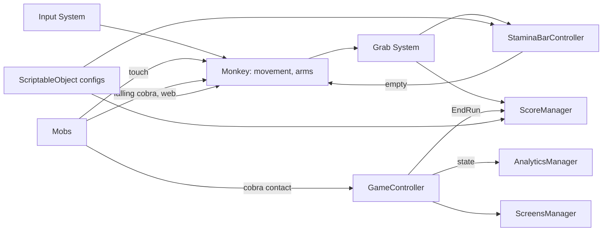
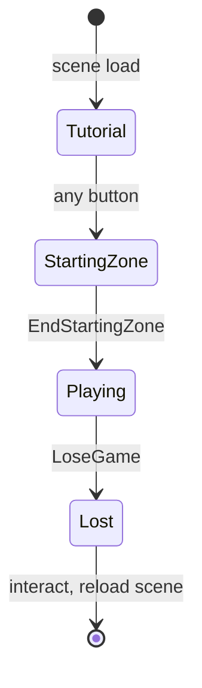

# Monkobra Technical Design Document

How Monkobra is built: the engine and packages, the run lifecycle, the systems that do not belong to one subsystem document, the conventions every script follows, and where to find the rest. Design intent is in the [Game Design Document](monkobra-gdd.md), controls and setup in the [README](../README.md), and the agent-facing system map in [CONTEXT.md](../CONTEXT.md).

## Document Map

| Document | Owns |
| --- | --- |
| [Game Design Document](monkobra-gdd.md) | what the player does and why: pillars, loop, mechanics, difficulty |
| This document | engine, architecture, run lifecycle, game balance, monkey, tree, stamina, score, UI, input, conventions |
| [Mobs](mob-doc.md) | cobra, falling cobra, branches, spider webs, and what each does when the monkey touches it |
| [Grab System](grab-doc.md) | detection zones, arm reach, release check, camera swap, outline feedback |
| [Build](build-doc.md) | the WebGL export, the three builds (WebGL for GitHub Pages, WebGL for itch.io, Windows) and their settings |
| [AGENTS.md](../AGENTS.md) | rules for agents |
| [CONTEXT.md](../CONTEXT.md) | descriptive system map and known gaps |
| [Balance Design](balance-doc.md) | why difficulty follows height, the per-segment roll model, the single balance asset |
| [CHANGELOG.md](../CHANGELOG.md) | version history |

A system gets its own document when it spans several scripts and carries rules a reader cannot see from one file. Everything else stays here.

## Stack

| Aspect | Value |
| --- | --- |
| Engine | Unity 6 (`6000.3.22f1`) |
| Render Pipeline | URP 17.3.0, with a PC and a Mobile asset under `Settings/_Shared/` |
| Input | Input System 1.20.0 |
| Camera | Cinemachine 3.1.7 (view swaps, impulse shake) |
| UI | uGUI 2.0.0 with TextMesh Pro |
| Target | WebGL on GitHub Pages, built from the Editor |
| Tests | none yet, `com.unity.test-framework` is installed |

## Scenes

| Scene | Purpose |
| --- | --- |
| `Lv1Scene` | the game and the only scene; its root is 8 prefab instances (`Cameras`, `DirectionalLight`, `GlobalVolume`, `EventSystem`, `Envs`, `Entities`, `GameController`, `UI`); `DTSPool` also holds the spider web and falling cobra spawners |

Personal copies of `Lv1Scene` are allowed for experiments, see [AGENTS.md](../AGENTS.md#git-workflow).

The folder layout and a script-by-script index are in [CONTEXT.md](../CONTEXT.md#repository-layout).

## Architecture

Subsystems talk through scene singletons, C# events, and trigger callbacks, not through direct scene references. Details are in [Conventions](#conventions).

## Run Lifecycle

`GameController` is the scene singleton that owns the `GameState` machine, exposed as `State` with a `StateChanged` event. A run only loses, it never wins.

| State | Time Scale | Screen |
| --- | --- | --- |
| Tutorial | 0 | tutorial panel, any button starts the run |
| StartingZone | 1 | none, run is live, `LoseGame` works, until `EndStartingZone()`, called by `StartingZoneExitRelay` when the monkey enters its trigger |
| Playing | 1 | none, never paused |
| Lost | 0 | lose panel, interact reloads the scene after `restartInputDelay` |

`LoseGame()` runs once, from StartingZone or Playing: the cobra touches the monkey ([Mobs](mob-doc.md#contact)). It carries no cause: analytics infers one itself (`DeathCauseResolver`): a branch hit or web encounter w/i `AnalyticsConfig.DeathCauseWindowS` before the loss names the cause, otherwise it is the great cobra. `LoseGame` calls `ScoreManager.EndRun` so the score settles, then enters Lost. `ScreensManager` owns the panels: they start deactivated, and it shows the current state's panel in `Start` and on every `StateChanged`.

Gameplay that must stop outside a run checks both `Time.timeScale <= 0` and the state. Grab, pickup, and scoring (`ArmController.TryGrabFruit`, `ScorePickup`, `ScoreManager.CanScore`) check `GameController.IsRunLive` (StartingZone or Playing); `SpiderWebStruggle` and the other HUD checkers still require `Playing`, so webs do not catch in the starting zone.

## Analytics

`AnalyticsManager` is a singleton component on the `GameController` prefab, not kept across reloads: a scene load starts a new session and file, and a reload in the middle of a run leaves that run unclosed at its last autosave. It observes the run (`GameController.StateChanged`, `ScoreManager.BananaCollected`, `HitBranchSensor.BranchHit`, `SpiderWebTrap.Encountered`), fills a `SessionData` of `RunData` entries, and `AnalyticsMarkdownWriter` renders it to one markdown file per scene load under `persistentDataPath/Analytics/`, rewritten on every save. Each run entry carries Mermaid graphs, and the file opens with a summary of lost runs. A run cut short by stopping Play mode, a scene reload, or the restart key is marked `Interrupted` and left out of the summary. Sample and autosave intervals and the death cause window are in `Settings/Analytics/AnalyticsConfig.asset`; the keys are in [Hack Shortcuts](#hack-shortcuts).

A WebGL player cannot reach `persistentDataPath` (it is a virtual IndexedDB filesystem), so the download key renders the session in memory and `WebDownload` hands it to the browser through `Plugins/WebGL/Download.jslib`. A run still open is rendered as it stands and keeps recording. Elsewhere the same key saves the session file and logs its path.

## Hack Shortcuts

Every dev key lives in one asset, `Settings/HackShortcuts/HackShortcutConfig.asset`, an instance of the `HackShortcutConfig` ScriptableObject: a list of entries, each a `HackAction`, a key, and a one-line description. Consumers look a key up with `GetKey(HackAction)` and skip it unless `HackShortcutConfig.IsActive`, ie a development build or the Editor, so none of them work in a release build.

| Key | Action | Read by |
| --- | --- | --- |
| F1 | toggle `GameController.CobraNoClip` | `GameController` |
| F8 | download the analytics session report | `AnalyticsManager` |
| F9 | close the analytics session and open a new file | `AnalyticsManager` |
| F10 | save a mock analytics session file | `AnalyticsManager` |

`HackShortcutPanel` on a TMP text writes these lines from the asset in `Awake`, and hides its object outside a development build. A new hack key is a new `HackAction` plus an entry in the asset.

## Game Balance

Every game balance number lives in one asset (how height becomes spawn chances is in [Balance Design](balance-doc.md)), `Settings/GameBalanceConfig.asset`, an instance of the `GameBalanceConfig` ScriptableObject. To tweak the game's feel, edit that single file and nothing else: no balance value is held in a second asset or hard-coded in a script.

| Group | Fields | Read by |
| --- | --- | --- |
| Stamina | `maxStamina`, `staminaUpwardDrainPerU`, `staminaSidewayDrainPerU`, `fruitStaminaRestore` | `StaminaBarController` |
| Movement | `upSpeedU`, `downSpeedU`, `exhaustedSpeedMultiplier`, `idleStaminaRecoveryPerS` | `MonkeyController` |
| Branch Hit | `hitStunDurationS`, `hitDropDistanceU`, `hitDropSpeedU` | `MonkeyController` |
| Score | `pointsPerMeter`, `unitsPerMeter`, `scoreRewardPoints` | `ScoreManager` |
| Ramped Difficulty | `rampedDifficultyCurve` | `RampedDifficultyManager` |
| Branch | `branchGenerationAttemptCount`, `startingZoneBranchClearRadiusU`, `branchSpawnProbabilityCurve`, `bananaSpawnProbabilityCurve` | `TreeSegmentController` |
| Spider Web | `webAttemptCount`, `webSpawnProbabilityCurve` | `SpiderWebSpawner` |
| Falling Cobra | `fallingCobraAttemptCount`, `fallingCobraSpawnProbabilityCurve`, `fallingCobraFallSpeedU`, `fallingCobraHorizontalSpeedU`, `fallingCobraReachWakeDistanceU`, `fallingCobraBananaAmbushChance`, `fallingCobraRehitGraceS`, `fallingCobraMaxHits` | `FallingCobraSpawner`, `FallingCobraController` |
| Great Cobra | `cobraBaseSpeedCurve`, `cobraSurgePerMistakeS`, `cobraMaxSurgeS`, `cobraSurgeSpeedPerMistakeU`, `cobraMaxSurgeSpeedU`, `cobraSpeedChangeRateU` | `CobraMotor` |

- Wiring: each reader holds a `GameBalanceConfig` inspector field (`balanceConfig` on `StaminaBarController`, `ScoreManager`, `MonkeyController`, `TreeSegmentController`, `RampedDifficultyManager`, `SpiderWebSpawner`, `FallingCobraSpawner`, and `CobraMotor` on the `GreatCobra` prefab), all pointing at the same asset
- Not Balance: the arm stroke and reach, orbit speed, acceleration, and input actions stay in `MonkeyConfig`; branch radius, spacing, and retries stay in `BranchFruitPlacementConfig`; web radius, spacing, clearance, retries, and the test override stay on `SpiderWebSpawner`; cobra spawn radius, spacing, retries, and ambush height stay on `FallingCobraSpawner`, and its trigger and fall distances on the falling cobra prefab
- Retired: `GameConfig`, `ScoreConfig`, and `ScoreReward` were folded into `GameBalanceConfig` and removed
- Suffixes: `U` is world units, `S` is seconds, `Deg` is degrees, `PerU` is per world unit travelled

The balance values in each section below are the current ones; change them in the asset, not in the section.

## Monkey Movement

`MonkeyController` drives the body. Its climb and stun numbers come from [Game Balance](#game-balance) and its orbit, acceleration, and input from `MonkeyConfig`.

- Body: kinematic, with gravity off. The script writes position and rotation outright through the Rigidbody, so no arm joint or collision can push it off its path
- Orbit: the horizontal input changes one angle, and the body sits exactly on a ring of fixed radius round its parent, the trunk
- Climb: the vertical input ramps a climb speed along world Y with separate acceleration and deceleration, and different maximums up and down
- Held: `IsHeld` freezes the body in place, set by the web trap ([Mobs](mob-doc.md#trap-and-escape))
- Stun: after a branch hit the input is ignored and the body falls a set distance ([Mobs](mob-doc.md#hit-penalty))
- Stamina Cost: each step reports upward and sideways distance to `StaminaBarController.DrainByMovement`. The stun fall and descending cost nothing

Climb speeds come from `Settings/GameBalanceConfig.asset`. Orbit speed, acceleration, and deceleration come from `Settings/_Shared/MonkeyConfig.asset`, which also holds the arm stroke and reach tuning covered by the [Grab System](grab-doc.md#tuning).

## Tree

The tree is a stack of static and dynamic trunk segments under a `TreeTop`, which carries no win zone: a run only loses.

- Extent: `TreeManager` (singleton `I`) holds `MinY` and `MaxY`, 0 and 100 by default, from the finite tree; nothing reads them any more; `FallingCobraSpawner` takes each segment's pivot as the trunk axis
- Climb Height: heights that drive difficulty are measured above the monkey's start y by `RampedDifficultyManager.GetClimbedYDistance`: branch density, banana chance, web chance, falling cobra chance, the score, and the height HUD. Nothing shifts the world origin; if something ever does, it only has to move `PlayerGameStartYPosition` along
- Segments: each `TreeSegmentController` places branches on itself in `Start` and in every `Restart` ([Mobs](mob-doc.md#placement)), then raises the static `BranchesGenerated`, which `SpiderWebSpawner` answers with webs ([Mobs](mob-doc.md#placement-1)) and `FallingCobraSpawner` with falling cobras ([Mobs](mob-doc.md#spawning))
- Pool: `DTSPool` sits on an empty object, finds the `Player`-tagged object once, and instantiates `segmentCount` copies of `segmentPrefab` end to end, the first (lowest) one created at the world height `firstSegmentY`. It keeps them in a FIFO: only when the stack top is less than `lookAheadU` above the player, and the lowest segment lies wholly under the player, that lowest one is moved over the stack top by `TreeSegmentController.Restart`, which clears its branches and webs and rolls branches again; the webs follow through `BranchesGenerated`, the pool never calls the spawner. Its `mockTree` field names an editor-only stand-in, `Envs/Tree` in `Lv1Scene`, that is deactivated at runtime, so nothing that must run may sit under it

## Stamina

`StaminaBarController` is a singleton `Slider` that reads `GameBalanceConfig`. `StaminaBarAnimator` on the same GameObject punches the bar on `FruitConsumed` and shakes it on `LowStaminaMoveAttempted`, which `MonkeyController` triggers through `NotifyMoveAttempt` while an input is held and stamina is below the `lowStaminaFraction` field of `StaminaBarController` (10% by default, 20% on the `Lv1Scene` instance) of the maximum. That threshold is feedback only and sits outside `GameBalanceConfig`; only an empty bar changes movement.

- Movement Drain: `DrainByMovement` per physics step, upward distance costs more than sideways; it is the only drain, nothing lowers the bar on a timer or while the monkey stands still
- Restore: `AddStaminaByFruit` adds the per-banana amount, capped at the maximum ([Grab System](grab-doc.md#on-a-successful-grab))
- Idle Recovery: `MonkeyController` adds `GameBalanceConfig.IdleStaminaRecoveryPerS` per second while no move key is pressed
- Depletion: reaching 0 does not end the run: `MonkeyController` scales upward climb speed only by `GameBalanceConfig.ExhaustedSpeedMultiplier` until stamina is above 0 again
- Label: the `StaminaBar` prefab carries a white TMP `Energy` label, `EnergyLabel`, above the left end of the bar; it is a child of the root, so it punches and shakes with the bar
- First Low Hint: `LowStaminaWidget` listens to the same `LowStaminaMoveAttempted`, so its once-per-scene hint opens with the first bar shake and cool-down pulse, at the same threshold ([UI](#ui))

All values live in `Settings/GameBalanceConfig.asset`.

## Score

`ScoreManager` (singleton `I`, on the `GameController` object) keeps two scores and notifies the UI when the total changes.

- Distance Score: whole meters of the highest point climbed, read from `RampedDifficultyManager.CurrentPlayerClimbedYDistance`, refreshed every frame (player y minus the y at game start), times points per meter. Only a new high counts, so falling and re-climbing earns nothing
- Reward Score: points from each banana collected through its `ScorePickup`; `ScoreManager.BananaCollectedCount` counts those pickups
- Gate: `CanScore` is true only after start, before `EndRun`, while unpaused, and while the game is not over
- Display: `ScoreWidget` shows the total on the HUD and on the lose panel

All values live in `Settings/GameBalanceConfig.asset`; `ScorePickup` carries no reward asset of its own.

The test scenes have no `ScoreManager`.

## Camera

Three Cinemachine cameras (behind, look-left, look-right) are swapped by priority. Every camera script sits on the main camera, next to the `CinemachineBrain`, and finds gameplay objects through their `I` singletons.

- Hit shake: `CameraHitShakeFeedback` reads `HitBranchSensor.I` and fires one of two `CinemachineImpulseSource` components on the camera by hit kind, light for a branch, heavy for a falling cobra. Amplitude and duration are tuned on the sources, and the strength a view feels also scales with its camera's impulse listener gain
- Cool-down: `CameraCoolDownFeedback` listens to `StaminaBarController.LowStaminaMoveAttempted` and pulses a URP Vignette on a global Volume plus a field-of-view widen on the live Cinemachine camera, easing both back to rest. It has two steps: a lighter one while stamina is below the low fraction, a stronger one once the bar is empty, and a low pulse in flight steps up when the bar empties. Both steps and the timing live in the `CameraEfxConfig` asset (the hit shake stays on its two impulse sources, since Cinemachine owns those values). A running pulse ignores repeats and a short cooldown follows

The swap rules are in the [Grab System](grab-doc.md#camera), the hit trigger in [Mobs](mob-doc.md#hit-penalty).

## Input

One asset, `Settings/_Shared/InputSystem_Actions`, holds all bindings, referenced through `InputActionReference` fields. The keys and buttons are listed under Controls in the [README](../README.md#controls).

- Move: shared by the body and both arms through `MonkeyConfig`
- Interact: the grab, read by both arms and the camera rig
- Jump: the web escape press, read by `SpiderWebStruggle`
- Collision: Space is bound to both Interact and Jump, so the struggle disables interact while the monkey is trapped

## UI

| Element | Script | Shows |
| --- | --- | --- |
| Stamina Bar | `UI/StaminaBarController` | current stamina, under an `Energy` label |
| Climb Progress | `UI/ProgressBarWidget` | a window `windowSizeY` tall below the monkey, with a marker for how near the cobra's head is |
| Score | `UI/ScoreWidget` | total score, on the HUD and the lose panel |
| Height | `UI/HeightDisplayWidget` | height climbed since game start, in world units |
| Screens | `UI/ScreensManager` | tutorial and lose panels |
| Lose Stats | `UI/LoseScreen` | final height (highest point climbed), final score, and bananas collected, filled each time the lose panel is enabled |
| Web Prompt | `UI/SpiderWebWidget` | first-trap hint and the escape bar ([Mobs](mob-doc.md#trap-and-escape)) |
| Low Stamina Prompt | `UI/LowStaminaWidget` | first-low-stamina hint, once per scene load, below the screen center |

`LowStaminaWidget` sits on an always-active Canvas child and toggles only its TMP label. The first `StaminaBarController.LowStaminaMoveAttempted` since the scene loaded, the event behind the bar shake and the camera cool-down, shows the hint for `showDurationS`; the script then drops its subscription, and nothing is static, so a reload brings the hint back. A loss hides it at once. While `SpiderWebStruggle.IsTrapped` it is hidden and its countdown waits, so it never shares the screen with the web prompt, and the rest plays after the escape; a held monkey reports no move attempts, so a trap can only cut in on a hint already showing. The label sits below the screen center, clear of the web prompt and the catch-up warning above it and of the vignette's dark edges; the Canvas has no render camera, so it draws as an overlay the vignette never darkens.

The tutorial in `Lv1Scene` uses editable uGUI Images under `TutorialScreen/KeyboardControls` for the WASD cluster and a wide Space key. Thin white Image rectangles form each outline without a sprite dependency; the WASD keys also have inset keycap frames and diagonal bevel lines. Each key has an explicit, stretched Background child with a dark gray Image (alpha 0.82), ordered before its outlines and label to preserve contrast over the white overlay. Letters are white, and `space` sits inside the long rectangular key at the bottom left. Its uGUI Text captions show `Move`, `Grab Banana`, and `Hold to reach, release to grab`; the existing start prompt remains below them. The original translucent white overlay (alpha 0.392) washes out the game behind the tutorial to indicate that the run has not started. `ScreensManager` shows and hides the whole panel as before.

`Fonts/UI/MonkobraTutorial-SemiBold.ttf` is a renamed, static weight-600 subset of [Noto Sans TC](https://github.com/google/fonts/tree/main/ofl/notosanstc), distributed with its SIL Open Font License in `Fonts/UI/OFL.txt`. It embeds printable ASCII and a small set of Chinese glyphs, so the tutorial renders in WebGL without system fonts. Wording that uses other characters requires extending the font subset or supplying a font with those glyphs. The subset has no em dash `—`; the TMP `LiberationSans SDF` atlas has one, so the low-stamina hint uses that font.

## Conventions

- Singletons: scene-scoped and first-wins. `TreeManager`, `UpwardFruitSensor`, `StaminaBarController`, and `ScoreManager` destroy a duplicate component only. `GameController` and `ScreensManager` destroy the duplicate's whole GameObject
- Start Over Awake: a consumer that may start before its singleton reads it in `Start`, so Awake order never matters
- Events Over Calls: detection scripts forward trigger events (`Entered`, `Exited`, `BranchHit`) rather than calling their consumers, and a segment announces its branches with `BranchesGenerated` rather than calling its decorators
- Tags: `Branch`, `FruitCollider`, and `Player` drive trigger matching. Webs match by a Rigidbody component instead
- Tuning In Data: values stay in serialized fields, and shared tuning sits in a ScriptableObject: balance numbers in `GameBalanceConfig` ([Game Balance](#game-balance)), monkey arm and input in `MonkeyConfig`, branch geometry in `BranchFruitPlacementConfig`. Gameplay values are never hard-coded
- Field Guards: required inspector fields are checked in `Awake` with a logged message naming the field
- Kinematic Body: nothing about the monkey is mass or gravity driven. Each arm is posed purely by its joint drives
- Style: `Player/`, `GameController/`, `Analytics/`, `MobGreatCobra/`, `MobFallingCobra/`, `UI/StaminaBarController`, `UI/ScreensManager`, and most of `Environment/` follow the house Unity style. `Scoring/`, `UI/ProgressBarWidget`, and `MobSpiderWeb/SpiderWebBuilder` are still in the template style, some with Chinese comments

## Build and Deploy

The only build is the WebGL export made from the Editor into `Monkobra/` and committed. Compression is disabled, because GitHub Pages cannot set response headers, and the `FitWindow` template keeps the game 16:9 at any window size. The steps and the required Player Settings are in [Build](build-doc.md).

## Known Gaps

Project-wide gaps are in [CONTEXT.md](../CONTEXT.md#known-gaps--constraints), subsystem ones in [Mobs](mob-doc.md#known-gaps) and the [Grab System](grab-doc.md#known-gaps).
